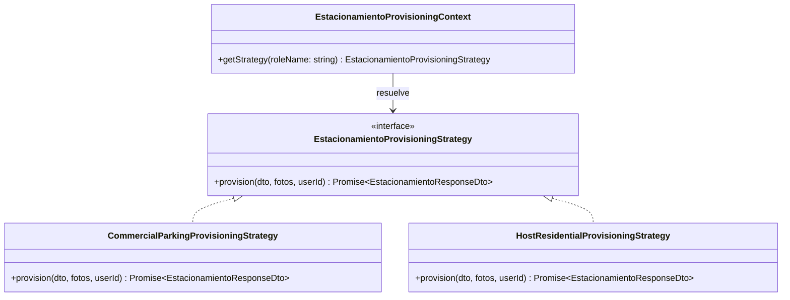

# Regla de Patrones de Diseño: Arquitectura ParkinGo (`parkingo-api` & `parking-go-front`)

Esta regla establece los **patrones de diseño oficiales y obligatorios** aplicados en la plataforma ParkinGo, con especial énfasis en la separación entre la administración de **Parqueos Comerciales B2B (`PARKING_ADMIN`)** y **Cocheras Residenciales C2C (`HOST`)**.

---

## 1. Patrones en Backend (`parkingo-api`)

### A. Patrón Strategy (GoF - Estrategia de Comportamiento)
* **Nombre:** `EstacionamientoProvisioningStrategy`
* **Explicación Técnica:** Define una familia de algoritmos de aprovisionamiento de estacionamientos desacoplados tras una interfaz común, permitiendo que `RegistrarEstacionamientoAction` delegue la ejecución a la estrategia correspondiente en tiempo de ejecución sin conocer los detalles de implementación interna.
* **¿Por qué se aplica en ParkinGo?:**
  1. **Evita la antipatrón de condicionales masivos (`if/switch` por rol):** El flujo comercial requiere creación en estado PENDIENTE con configuración manual diferida de pisos y boxes, mientras que el flujo de anfitrión residencial requiere creación atómica inmediata de Nivel, Espacio, Croquis y Tarifa.
  2. **Principio Open/Closed (OCP):** Si mañana se introduce un nuevo modelo (ej. *"Parqueo por Valet"*, *"Eventos Temporales"*), se añade una nueva estrategia sin alterar ni poner en riesgo la lógica comercial ni residencial existente.
  3. **Separación de Responsabilidades:** Cada estrategia encapsula exclusivamente sus propias reglas de negocio y validaciones de cuota.

---

### B. Patrón Factory Method (GoF - Creacional)
* **Nombre:** `HostDefaultStructureFactory`
* **Explicación Técnica:** Encapsula la creación y ensamblado de las entidades y estructuras complejas por defecto que componen una cochera residencial (código de nivel `"PLANTA-BAJA"`, código de box `"BOX-1"`, y el árbol JSON de nodos de canvas para el croquis 2D).
* **¿Por qué se aplica en ParkinGo?:**
  1. **Elimina la sobrecarga cognitiva al Anfitrión:** El dueño de casa no debe verse forzado a inventar nombres de pisos ni diseñar un plano arquitectónico desde cero.
  2. **Estandarización de Datos:** Asegura que todos los garajes residenciales se inicialicen con dimensiones válidas en píxeles y metros (70x120 px, muros perimetrales de 20 px y portón de entrada con barrera).

---

### C. Patrón Unit of Work / Database Transaction Script (Persistencia ACID)
* **Nombre:** Transacción Atómica con Prisma (`prisma.$transaction`)
* **Explicación Técnica:** Agrupa la creación del Tenant personal, Estacionamiento, Nivel, Espacio, Croquis y Tarifa en una única transacción de base de datos con semántica de *todo o nada*.
* **¿Por qué se aplica en ParkinGo?:**
  1. **Integridad Referencial Absoluta:** Si la subida de fotos o la creación del croquis falla, la transacción hace *rollback* completo, evitando que queden estacionamientos huérfanos sin nivel o niveles sin espacio en la base de datos PostgreSQL.
  2. **Idempotencia:** Garantiza que la cuota estricta 1:1:1:1 del anfitrión no se corrompa por inserciones parciales ante fallos de red.

---

## 2. Patrones en Frontend (`parking-go-front`)

### A. Patrón Stepper Wizard / Compound Component (UI Creacional)
* **Nombre:** `HostOnboardingWizard`
* **Explicación Técnica:** Divide un proceso complejo de captura de datos en pasos secuenciales cohesivos y autocontenidos (Paso 1: Ubicación & Fachada ➔ Paso 2: Vehículo & Precios ➔ Paso 3: Timbre & Reglas de Casa), compartiendo un estado unificado antes de realizar el despacho al backend.
* **¿Por qué se aplica en ParkinGo?:**
  1. **Conversión y Usabilidad (UX Airbnb-style):** Los dueños de casa abandonan el proceso si se les presentan tablas complejas y pestañas técnicas B2B. El wizard reduce la fricción a menos de 2 minutos.
  2. **Validación Progresiva:** Cada paso valida sus propios campos antes de permitir el avance, proporcionando feedback inmediato sin saturar la pantalla con errores masivos.

---

### B. Patrón UI Policy / Strategy (Comportamiento y Presentación)
* **Nombre:** `useHostParkingPolicy` / Políticas Visuales por Rol
* **Explicación Técnica:** Centraliza las reglas de visualización, visibilidad de pestañas y diccionario de terminología adaptado según el rol del usuario en sesión (`HOST` vs `PARKING_ADMIN`).
* **¿Por qué se aplica en ParkinGo?:**
  1. **Desacoplamiento de Copywriting:** Evita que componentes visuales tengan lógica dispersa de cadenas de texto (`isHost ? 'Mi Cochera' : 'Sucursal'`).
  2. **Control de Acceso Visual:** Oculta pestañas inaplicables (como *Gestión de Operadores*) y bloquea herramientas de creación de plazas excedentes en el lienzo Konva 2D.

---

### C. Patrón Facade (Estructural / Aplicación)
* **Nombre:** `useHostOnboardingWizard`
* **Explicación Técnica:** Expone una interfaz simplificada y de alto nivel a los componentes del wizard, ocultando las peticiones a la API, la preparación del FormData multipart, el manejo de errores de Axios y la invalidación de caché de TanStack Query.
* **¿Por qué se aplica en ParkinGo?:**
  1. **Cumplimiento de la regla `frontend-workflow.md`:** Mantiene los componentes visuales `.tsx` limpios y libres de llamadas HTTP directas.
  2. **Testabilidad:** Permite probar el flujo de onboarding aislando completamente la lógica de negocio de la capa de renderizado.

---

## 3. Mandato de Cumplimiento Obligatorio

1. **Prohibido agregar condicionales por rol dentro de las acciones de aprovisionamiento:** Toda lógica diferenciada entre modelos de parqueo debe encapsularse en una implementación de `EstacionamientoProvisioningStrategy`.
2. **Prohibido solicitar al rol Anfitrión pasos de configuración manual de niveles o planos:** Todo flujo residencial debe utilizar la fábrica de plantillas por defecto y el wizard de onboarding de 1 paso.
3. **Mantenimiento del Grafo:** Todo nuevo servicio, estrategia o fábrica debe registrarse en `backend_graph.json`.
