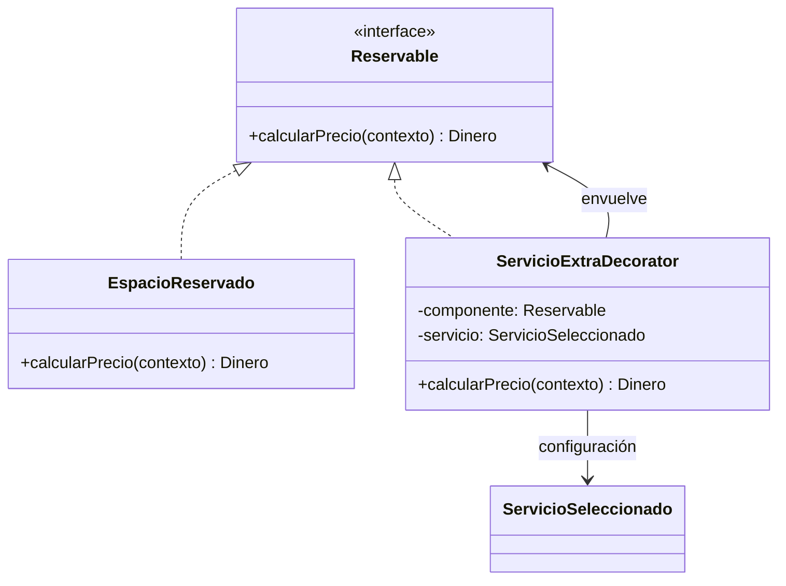

# Skill: patrón de diseño Decorator (GoF)

## 0. Objetivo y contrato

Aplicar **Decorator** correctamente para añadir responsabilidades a un objeto individual mediante envoltorios que respetan un contrato común. Favorecer extensión sin modificar clases de dominio ya estables, pero **no forzar Decorator** cuando una lista de líneas y una suma directa resuelvan mejor el problema.

Reglas innegociables:
1. **Inspeccionar primero el repositorio**: lenguajes, convenciones, módulos, arquitectura, entidades, DTO, migraciones, pruebas, control de acceso y reglas de negocio. No asumir un stack.
2. Respetar las interfaces, patrones y nombres existentes; proporcionar un plan corto antes de cambiar el código.
3. Distinguir **catálogo persistente**, **selección en una reserva**, **cálculo de precio** y **documento/boleta**. No confundirlos.
4. Para servicios dinámicos de base de datos, usar **un decorador genérico parametrizado con datos** y no subclases por cada servicio.
5. Aplicar el decorador al **componente que recibe el extra** (por ejemplo, un espacio reservado), no automáticamente a la factura, boleta o carrito completo.
6. La composición de varios componentes puede implementarse con una colección ordinaria; usar Composite solo cuando aporte una necesidad real de interfaz uniforme y composición recursiva.
7. Nunca confiar en importes suministrados por el cliente: recálculo y validación en servidor, con una captura histórica del precio acordado.
8. No cambiar código sin antes localizar los puntos de integración, e informar qué archivos se modificarán. Evitar refactorizaciones ajenas al alcance.

## 1. Concepto preciso

Decorator es un patrón estructural GoF que permite adjuntar responsabilidades adicionales a un objeto mediante composición. El decorador implementa la misma interfaz pública del componente que envuelve y delega parte del trabajo al componente interior.

Roles:
- **Component**: contrato común, p. ej. `Reservable` o `Priceable`, con `calcularPrecio(contexto)`.
- **ConcreteComponent**: implementación base, p. ej. `EspacioReservado`, que calcula su tarifa sin extras.
- **Decorator**: clase base opcional que implementa Component y encapsula otro Component.
- **ConcreteDecorator**: añade comportamiento; con datos configurables, basta un **`ServicioExtraDecorator` genérico**.
- **Client/Assembler**: construye la cadena a partir de una selección validada por el servidor.

Esquema UML conceptual:



**Advertencia**: un decorador **no es una entidad de servicio**, ni una tabla de join, ni una jerarquía de tipos de servicios. Las instancias del decorador pueden ser objetos de aplicación transitorios reconstruidos a partir de registros persistidos.

## 2. Árbol de decisión: ¿aplicar Decorator?

1. ¿Los objetos reciben responsabilidades opcionales y combinables de forma individual? Si no, no usar Decorator por costumbre.
2. ¿Se necesita que cada combinación conserve la misma interfaz que el elemento base? Si sí, Decorator es candidato.
3. ¿El requisito es solo sumar ítems de una boleta y persistir líneas? Usar agregado + líneas de detalle; Decorator puede ser innecesario.
4. ¿Los extras provienen de una base de datos y los usuarios crean nuevos nombres? Usar **decorador genérico impulsado por datos**; no generar código por servicio.
5. ¿Existen distintas reglas de precio por hora, día, tamaño, temporada, ocupación o tipo de servicio? Considerar una estrategia/política de precio separada; Decorator debe orquestar la adición, no contener cientos de condicionales.
6. ¿Se necesitan agregados anidados calculables como una unidad? Considerar Composite, pero no introducirlo únicamente porque exista una lista.
7. ¿Hay descuentos, impuestos o promociones a nivel boleta? Tratarlos separadamente según su ámbito y orden legal/comercial; no aplicarlos como extras de un espacio si no pertenecen allí.

## 3. Invariantes de diseño

- **Sustituibilidad:** `EspacioReservado` y `ServicioExtraDecorator` cumplen `Reservable`.
- **Delegación:** `ServicioExtraDecorator.calcularPrecio()` llama al componente interno y añade el precio de su servicio, sin volver a calcular ni duplicar los extras anteriores.
- **Asociación correcta:** cada decorador contiene un único servicio seleccionado para un único detalle de reserva.
- **Identidad separada:** el espacio del catálogo puede aparecer en diferentes reservas; el objeto decorado es la selección contextualizada de ese espacio para esa reserva y período.
- **Sin clases dinámicas:** un nuevo registro en `ServicioExtra` no requiere recompilar la aplicación.
- **Cálculo determinista:** misma reserva, tarifas fijadas y contexto producen el mismo total.
- **Precisión:** para dinero, `BigDecimal`, `Decimal` o tipo de dinero equivalente; jamás `float/double` para cálculo monetario.
- **Moneda:** no sumar valores en monedas diferentes sin una política explícita de conversión.
- **Cantidades y períodos:** unidades explícitas y una política de redondeo fijada por el negocio.
- **Inmutabilidad recomendada:** un decorador de precios no debe editar los registros persistidos durante el cálculo.
- **Validación antes del ensamblado:** el servicio debe existir, pertenecer al operador autorizado, estar activo, ser elegible para el espacio y admitir su cantidad solicitada.
- **Idempotencia lógica:** construir una cadena una vez por selección; no aplicar dos veces el mismo extra accidentalmente. Si el negocio admite cantidad mayor a uno, modelarla explícitamente.
- **Separar cotización de reserva confirmada:** precio estimado y precio pactado no son lo mismo.

## 4. Modelo conceptual para espacios y extras

Recomendación mínima, ajustable al esquema existente:

```text
Usuario/Operador (dueño del catálogo)
  ├── Espacio (id, tipo, estado, tarifa vigente, moneda)
  └── ServicioExtra (id, nombre, activo, reglaTarifa, tarifa vigente, moneda)

BoletaReserva (id, cliente, estado, fechas, moneda, total, ...) 
  └── DetalleReserva (id, boleta_id, espacio_id, intervalo, tarifaBaseSnapshot, subtotal)
       └── ServicioContratado (id, detalle_id, servicio_id, cantidad, tarifaSnapshot, subtotal)
```

Si hay limitaciones de compatibilidad por espacio, revisar una relación de elegibilidad (por ejemplo, `EspacioServicioPermitido` o `TipoEspacioServicio`) **solo si** los requisitos la demandan.

**Snapshots obligatorios para precios históricos**: guardar la descripción y la tarifa/precio acordados en las líneas de reserva; la factura pasada no debe cambiar cuando se edita el catálogo. Guardar moneda, unidades, cantidad y regla aplicable o su versión cuando sea necesario. Congelar la cotización de manera transaccional al confirmar, siguiendo las reglas del negocio.

El patrón Decorator actúa en la capa de dominio/aplicación. Persistir datos de la reserva en tablas normales; no intentar serializar una cadena recursiva de decoradores con ORM por defecto.

## 5. Ensamblado del decorador

Flujo obligatorio:

1. Recibir solicitud con identificadores de espacios, fechas/intervalos y servicios elegidos con cantidades. Nunca aceptar tarifas del cliente como fuente de verdad.
2. Resolver identidades y permisos del usuario autenticado; confirmar propiedad del estacionamiento/operador.
3. Validar que los espacios estén disponibles y que el intervalo y la capacidad sean válidos.
4. Consultar tarifas y reglas vigentes en una fuente controlada por servidor; evitar consultas repetitivas (N+1).
5. Calcular el componente base `EspacioReservado` en su contexto temporal.
6. Para cada servicio válido, envolver: `precio = new ServicioExtraDecorator(precio, servicioSeleccionado)` (pseudocódigo).
7. Obtener el subtotal del espacio desde el último decorador.
8. Crear líneas de detalle y snapshots de cada precio; sumar todos los detalles para el total de boleta.
9. Validar consistencia, concurrencia y reglas de descuentos/impuestos si existen.
10. Confirmar con transacción atómica y gestión de conflictos por intervalos; devolver la boleta con desglose.

Pseudocódigo independiente de lenguaje:

```text
crearPrecioEspacio(espacio, intervalo, serviciosElegidos):
    actual: Reservable = EspacioReservado(espacio, intervalo, tarifaBaseSnapshot)
    para seleccion en serviciosElegidosOrdenados:
        servicio = validarYResolverSeleccion(seleccion)
        actual = ServicioExtraDecorator(actual, servicio, reglaPrecioSnapshot)
    devolver actual

calcularBoleta(detalles):
    total = Dinero.cero(monedaBoleta)
    para detalle en detalles:
        total = total + crearPrecioEspacio(detalle.espacio, detalle.intervalo, detalle.servicios).calcularPrecio()
    devolver total
```

El orden de decoradores aditivos simples no afecta el total. Si hay cálculos no conmutativos (descuentos o recargos porcentuales), definir un orden explícito y probarlo.

## 6. Ejemplo de referencia en Java (ilustrativo, no imponer Java)

```java
import java.math.BigDecimal;
import java.util.Objects;

interface Reservable {
    BigDecimal calcularPrecio();
}

record ServicioSeleccionado(String id, BigDecimal precioAplicado) {
    ServicioSeleccionado {
        Objects.requireNonNull(id);
        Objects.requireNonNull(precioAplicado);
        if (precioAplicado.signum() < 0) throw new IllegalArgumentException("Tarifa negativa");
    }
}

record EspacioReservado(BigDecimal tarifaBaseAplicada) implements Reservable {
    EspacioReservado {
        Objects.requireNonNull(tarifaBaseAplicada);
        if (tarifaBaseAplicada.signum() < 0) throw new IllegalArgumentException("Tarifa negativa");
    }
    @Override public BigDecimal calcularPrecio() { return tarifaBaseAplicada; }
}

final class ServicioExtraDecorator implements Reservable {
    private final Reservable componente;
    private final ServicioSeleccionado servicio;

    ServicioExtraDecorator(Reservable componente, ServicioSeleccionado servicio) {
        this.componente = Objects.requireNonNull(componente);
        this.servicio = Objects.requireNonNull(servicio);
    }

    @Override public BigDecimal calcularPrecio() {
        return componente.calcularPrecio().add(servicio.precioAplicado());
    }
}

// Ejemplo: 150 + 30 + 50 = 230
Reservable precio = new EspacioReservado(new BigDecimal("150.00"));
precio = new ServicioExtraDecorator(precio, new ServicioSeleccionado("luz", new BigDecimal("30.00")));
precio = new ServicioExtraDecorator(precio, new ServicioSeleccionado("arbitro", new BigDecimal("50.00")));
BigDecimal subtotal = precio.calcularPrecio();
```

Nota: `precioAplicado` es un monto **ya calculado** para la cantidad y duración correspondientes. Si se necesita cobrar por hora/unidad, definir un contrato `ReglaPrecio` o `EstrategiaTarifa` y obtener el importe aplicado antes de envolver o durante una operación explícita con contexto. Para código de producción, adaptar el ejemplo al lenguaje y estándares de la base de código. Java no admite sentencias sueltas en todos los contextos: colocar el ejemplo de uso dentro de un método o prueba.

## 7. Modalidades tarifarias y extensibilidad

Considerar si el dominio exige:
- `FIJO_POR_RESERVA`: tarifa una vez por selección.
- `POR_HORA`: tarifa por unidades de tiempo según una política de fraccionamiento.
- `POR_DIA`: tarifa por día de acuerdo con reglas calendario/24 horas.
- `POR_UNIDAD`: tarifa × cantidad.
- `POR_VEHICULO`: si el modelo permite múltiples vehículos por detalle.
- `ESCALONADA`: tramos de permanencia.

No asumir que todas existen. Implementar solo las modalidades confirmadas, dejando un punto de extensión claro. Si cada modalidad tiene algoritmo propio, `Strategy` o políticas de cálculo colaboran con Decorator; el decorador no sustituye al motor tarifario.

Ejemplo de contrato conceptual:

```text
TariffPolicy.calculate(rateSnapshot, interval, quantity, context) -> Money
ServiceExtraDecorator.calculate() -> wrapped.calculate() + policy.calculate(...)
```

## 8. Integración con APIs, persistencia y transacciones

- Preferir endpoints y convenciones del repositorio. No inventar rutas incompatibles.
- DTO de entrada basado en IDs, fechas/horas, cantidades y servicios seleccionados. Rechazar IDs inexistentes y cantidades inválidas.
- DTO de salida con número/id de boleta, estado, períodos, cada espacio, tarifa base, cada servicio, moneda, cantidades, subtotales y total.
- Validar disponibilidad **por intervalo**, no solo con `espacio.ocupado == true`.
- Una consulta previa de disponibilidad es insuficiente contra solicitudes concurrentes: usar mecanismos transaccionales/bloqueos/restricciones de exclusión apropiados al motor de datos, y probar condiciones de carrera.
- Prohibir extras de otro operador, otro estacionamiento, deshabilitados o no habilitados para ese espacio.
- Versionar o congelar las tarifas para el momento de confirmación. Definir manejo de cambios entre cotización y confirmación.
- Garantizar rollback completo si falla alguna línea de la boleta.
- Idempotencia de creación cuando la aplicación y el tráfico lo requieran (clave de idempotencia).
- Evitar confiar en el total del front y filtrar datos según permisos en todas las consultas.
- Al cancelar, seguir política de reversión/liberación de disponibilidad existente, sin eliminar auditabilidad.

## 9. Pruebas imprescindibles

**Unitarias de Decorator**
1. Un espacio sin extras devuelve su tarifa base.
2. Uno o varios extras suman correctamente (sin duplicaciones).
3. El orden de extras aditivos no cambia el total.
4. La misma clase genérica acepta servicios nuevos de BD sin clases adicionales.
5. Se rechazan tarifas nulas, negativas cuando no son permitidas, moneda inconsistente y cantidades inválidas.
6. Recalcular no modifica estado ni cambia resultado.
7. Se respetan reglas de duración, redondeo y moneda.

**Dominio/servicio**
8. Una boleta con tres espacios, servicios diferentes y un espacio sin servicios suma sus subtotales.
9. Un servicio pertenece al detalle correcto, no a toda la boleta.
10. Un servicio repetido se rechaza o se agrupa por cantidad según reglas acordadas.
11. No se permite servicio desactivado/no autorizado/no compatible.
12. Cambiar la tarifa del catálogo no altera una boleta confirmada.

**Integración/concurrencia**
13. La transacción de confirmación crea boleta y todos sus detalles o ninguno.
14. Dos solicitudes simultáneas para un mismo espacio e intervalo no producen doble reserva.
15. Intervalos adyacentes y traslapados se comportan según definición documentada.
16. Los errores devuelven estados apropiados, mensajes seguros y no filtran datos de otros usuarios.
17. Reintentos idempotentes no duplican boletas si el sistema soporta esa garantía.
18. La consulta posterior reconstruye correctamente el desglose histórico.

## 10. Antipatrones y errores frecuentes

- **Una subclase por nombre de servicio** cuando los registros son configurables por usuarios.
- Decorar la boleta con servicios específicos de espacios: pierde la asociación local.
- Hacer que Decorator ejecute escrituras ORM o peticiones HTTP en cada `calcularPrecio`.
- Usar `double`, `float`, concatenaciones o redondeos inconsistentes para dinero.
- Confiar en precios enviados por el navegador.
- Persistir referencias a objetos decoradores como sustituto de líneas de detalle.
- Aplicar el mismo extra dos veces por defecto después de editar una selección.
- Hacer una clase con grandes `switch` por los nombres visibles de servicios.
- Usar Composite por obligación, cuando solo se necesita suma de una lista.
- Modelar disponibilidad como un booleano global sin tiempo.
- Bloquear solo desde la interfaz o hacer `check then insert` sin control transaccional.
- Recalcular reservas históricas usando tarifas nuevas.
- Confundir un extra opcional con una prestación intrínseca incluida en la tarifa base.
- Hacer cambios masivos en proyecto preexistente sin pruebas de regresión.

## 11. Proceso obligatorio del agente en un repositorio

### Fase A: inspección
- Identificar estructuras y dependencias, módulos de estacionamiento, espacios, tarifas, reservas, servicios, usuarios, permisos y notificaciones.
- Localizar pruebas y migraciones.
- Declarar decisiones asumidas y preguntas bloqueantes **solo cuando no exista alternativa razonable**.

### Fase B: diseño
- Presentar modelo de dominio y relaciones con cardinalidades.
- Identificar `Component`, `ConcreteComponent`, `Decorator`, `ServicioSeleccionado` y ensamblador.
- Mostrar dónde se persisten `BoletaReserva`, `DetalleReserva` y `ServicioContratado`.
- Describir cálculo total y límites de transacción.

### Fase C: implementación mínima
- Implementar componentes manteniendo arquitectura existente.
- Inyectar/crear decoradores desde selecciones validadas.
- Mantener servicios de catálogo y snapshots separados de comportamiento temporal.
- Evitar introducir dependencias no necesarias.

### Fase D: verificación
- Ejecutar pruebas pertinentes del proyecto y añadir casos unitarios/integración.
- Ejecutar build/lint/migraciones verificables, sin destruir datos.
- Documentar rutas, migraciones, comandos de prueba y resultados.

### Fase E: entrega
- Resumir archivos creados/modificados, decisiones, límites, pruebas y riesgos restantes.
- Marcar explícitamente cualquier prueba no ejecutada o supuesto no confirmado.

## 12. Criterios de aceptación de la skill

La implementación es aceptable si (1) un espacio aislado conserva su contrato, (2) cualquier servicio de catálogo puede añadirse mediante el mismo decorador genérico, (3) cada servicio se asocia a un único detalle seleccionado, (4) la boleta agrega subtotales exactos, (5) persiste el desglose histórico, (6) valida permisos y disponibilidad, (7) no permite doble reserva en concurrencia, y (8) cuenta con pruebas de la lógica central.

## 13. Regla de salida del agente

Al finalizar, responder con: **Arquitectura aplicada**, **Flujo de cálculo**, **Archivos modificados**, **Pruebas ejecutadas y resultados**, **Decisiones de negocio pendientes**. No afirmar que un test pasó si no se ejecutó. Si el patrón no se justifica, explicarlo y sugerir una composición simple antes de programar.
