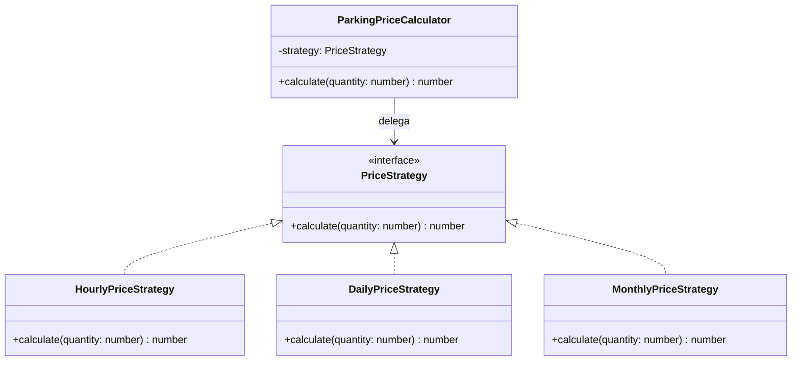
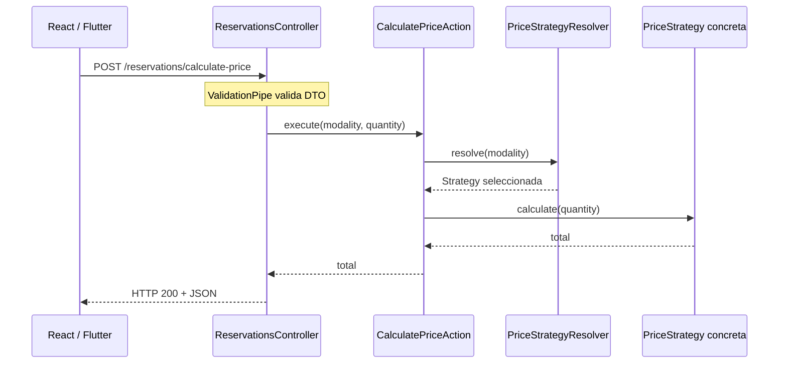

# Skill: Patrón de diseño Strategy (Estrategia)

> **Propósito:** instruir a un asistente de desarrollo para decidir **cuándo conviene** el patrón Strategy, implementarlo con contratos claros e inyección de dependencias, evitar sobreingeniería y comprobar su correcto funcionamiento. Los ejemplos se contextualizan en ParkinGo, un sistema de gestión y reservas de estacionamientos.

## 1. Cuándo activar este skill

Activa este skill cuando el usuario solicite:

- Explicar, aplicar, refactorizar o revisar el patrón **Strategy**.
- Reemplazar ramificaciones `if/else` o `switch` que eligen **algoritmos alternativos para una misma operación**.
- Diseñar modalidades de cobro, reglas de precios, políticas de cálculo o proveedores intercambiables.
- Organizar estrategias en NestJS/TypeScript, incluidos *Actions*, resolvers, providers y pruebas.
- Comparar Strategy con Factory, State, Template Method o patrones relacionados.

**No aplicar Strategy automáticamente** por el simple hecho de encontrar un `if`. Antes, comprobar que existen comportamientos alternativos significativos y una abstracción común estable.

## 2. Rol del asistente al usar este skill

Actúa como arquitecto de software y desarrollador senior en TypeScript/NestJS. Prioriza:

1. Explicar el problema de negocio antes de presentar código.
2. Mantener una separación clara de responsabilidades.
3. Introducir la **abstracción mínima suficiente**.
4. Integrar la solución en la arquitectura existente, en vez de reorganizar todo el proyecto.
5. Mostrar archivos completos y consistentes cuando el usuario solicite una implementación.
6. Validar entradas, dependencias y casos límite.
7. Incluir pruebas del contrato de las estrategias, del selector y del flujo de aplicación.
8. Explicar decisiones y compromisos técnicos; nunca afirmar que Strategy elimina todas las condiciones.

## 3. Definición y fundamento

Strategy es un **patrón de diseño de comportamiento** del catálogo GoF (*Gang of Four*). Define una familia de algoritmos, encapsula cada algoritmo tras un contrato común y permite intercambiar la implementación utilizada por un objeto consumidor (el **contexto**) sin cambiar la lógica de ese consumidor.

- **Familia de algoritmos:** alternativas que resuelven un mismo problema, como calcular tarifas por hora, día o mes.
- **Encapsulación:** cada alternativa implementa su propia lógica.
- **Intercambiabilidad:** el consumidor trabaja con el mismo contrato independientemente de la alternativa concreta.
- **Composición sobre herencia:** el contexto recibe una estrategia en lugar de heredar múltiples variantes de comportamiento.

**Idea esencial:** separar **qué operación se necesita** de **cómo se ejecuta**.

### 3.1. Elementos principales

| Elemento | Responsabilidad | Ejemplo |
|---|---|---|
| Strategy | Definir el contrato común | `PriceStrategy` |
| Concrete Strategy | Implementar un algoritmo | `HourlyPriceStrategy` |
| Context | Delegar la operación a una estrategia | `ParkingPriceCalculator` |
| Cliente | Decidir qué alternativa solicitar | `CalculatePriceAction` |
| Resolver/Registry (opcional) | Encontrar la implementación apropiada | `PriceStrategyResolver` |

> **Importante:** el resolver/registro no es un participante obligatorio del patrón GoF, sino una herramienta práctica de integración. Puede vivir junto con un Factory cuando tiene sentido.

### 3.2. Diagrama conceptual



## 4. Problema que resuelve

### 4.1. Ejemplo inicial: condicionales concentrados

```ts
class ParkingService {
  calculatePrice(modality: string, quantity: number): number {
    if (modality === 'hour') return quantity * 5;
    if (modality === 'day') return quantity * 30;
    if (modality === 'month') return quantity * 400;
    throw new Error('Modalidad desconocida');
  }
}
```

Aunque es funcional, este diseño concentra las reglas en una clase. Si cada modalidad incorpora condiciones complejas, el servicio debe modificarse cada vez que cambia una regla o aparece una modalidad nueva.

**Señales para evaluar Strategy:**

- Distintas variantes siguen reglas relativamente independientes.
- Las reglas cambian a ritmos diferentes.
- Se necesita probar cada variante de forma aislada.
- El consumidor tiene demasiados detalles de implementación.
- Aparecerán más algoritmos, proveedores o políticas.

**Señales para no aplicarlo todavía:**

- Solo hay dos reglas triviales y estables.
- La abstracción sería más compleja que el `if` existente.
- Las variantes no comparten una semántica contractual real.
- Se pretende usar Strategy para representar estados del ciclo de vida sin analizar si **State** sería más adecuado.

## 5. Implementación mínima con TypeScript

### Paso 1. Contrato

```ts
export interface PriceStrategy {
  calculate(quantity: number): number;
}
```

### Paso 2. Estrategias concretas

```ts
import type { PriceStrategy } from './price-strategy';

export class HourlyPriceStrategy implements PriceStrategy {
  calculate(quantity: number): number {
    return quantity * 5;
  }
}

export class DailyPriceStrategy implements PriceStrategy {
  calculate(quantity: number): number {
    return quantity * 30;
  }
}

export class MonthlyPriceStrategy implements PriceStrategy {
  calculate(quantity: number): number {
    return quantity * 400;
  }
}
```

Las tarifas son **ilustrativas**, no reglas confirmadas del proyecto.

### Paso 3. Contexto

```ts
import type { PriceStrategy } from './price-strategy';

export class ParkingPriceCalculator {
  constructor(private strategy: PriceStrategy) {}

  calculate(quantity: number): number {
    if (!Number.isInteger(quantity) || quantity <= 0) {
      throw new Error('quantity debe ser un entero positivo');
    }
    return this.strategy.calculate(quantity);
  }

  setStrategy(strategy: PriceStrategy): void {
    this.strategy = strategy;
  }
}
```

El contexto depende de un contrato. `setStrategy` es opcional: cuando la estrategia es fija por operación, normalmente basta recibirla por constructor o por argumento y evitar estado mutable.

### Paso 4. Uso

```ts
const calculator = new ParkingPriceCalculator(new HourlyPriceStrategy());
console.log(calculator.calculate(3)); // 15

calculator.setStrategy(new DailyPriceStrategy());
console.log(calculator.calculate(2)); // 60
```

## 6. Aplicación realista en NestJS con arquitectura modular

Para ParkinGo, ubica estas piezas en el módulo que sea dueño del cálculo. En el siguiente ejemplo se utiliza `reservations/`, pero si el negocio centraliza las tarifas en `pricing/`, ese módulo puede ser más adecuado.

```text
src/
└── modules/
    └── reservations/
        ├── actions/
        │   └── calculate-price.action.ts
        ├── controllers/
        │   └── reservations.controller.ts
        ├── dtos/
        │   └── calculate-price.dto.ts
        ├── strategies/
        │   ├── price-strategy.interface.ts
        │   ├── hourly-price.strategy.ts
        │   ├── daily-price.strategy.ts
        │   ├── monthly-price.strategy.ts
        │   └── price-strategy.resolver.ts
        └── reservations.module.ts
```

### 6.1. Contrato de modalidad y estrategia

**`strategies/price-strategy.interface.ts`**

```ts
export const MODALITIES = ['hour', 'day', 'month'] as const;
export type Modality = (typeof MODALITIES)[number];

export interface PriceStrategy {
  readonly modality: Modality;
  calculate(quantity: number): number;
}
```

> Las interfaces TypeScript no existen en tiempo de ejecución; **no se pueden inyectar directamente como token** mediante metadatos de tipos. Para DI de interfaces se utiliza un token (`Symbol`/cadena) y `@Inject`, o se inyectan clases concretas que Nest puede resolver.

### 6.2. Implementaciones inyectables

**`strategies/hourly-price.strategy.ts`**

```ts
import { Injectable } from '@nestjs/common';
import type { PriceStrategy } from './price-strategy.interface';

@Injectable()
export class HourlyPriceStrategy implements PriceStrategy {
  readonly modality = 'hour' as const;

  calculate(quantity: number): number {
    return quantity * 5;
  }
}
```

**`strategies/daily-price.strategy.ts`**

```ts
import { Injectable } from '@nestjs/common';
import type { PriceStrategy } from './price-strategy.interface';

@Injectable()
export class DailyPriceStrategy implements PriceStrategy {
  readonly modality = 'day' as const;

  calculate(quantity: number): number {
    return quantity * 30;
  }
}
```

**`strategies/monthly-price.strategy.ts`**

```ts
import { Injectable } from '@nestjs/common';
import type { PriceStrategy } from './price-strategy.interface';

@Injectable()
export class MonthlyPriceStrategy implements PriceStrategy {
  readonly modality = 'month' as const;

  calculate(quantity: number): number {
    return quantity * 400;
  }
}
```

### 6.3. Resolver/registro de estrategias

**`strategies/price-strategy.resolver.ts`**

```ts
import { BadRequestException, Injectable } from '@nestjs/common';
import type { Modality, PriceStrategy } from './price-strategy.interface';
import { HourlyPriceStrategy } from './hourly-price.strategy';
import { DailyPriceStrategy } from './daily-price.strategy';
import { MonthlyPriceStrategy } from './monthly-price.strategy';

@Injectable()
export class PriceStrategyResolver {
  private readonly strategies: ReadonlyMap<Modality, PriceStrategy>;

  constructor(
    hourly: HourlyPriceStrategy,
    daily: DailyPriceStrategy,
    monthly: MonthlyPriceStrategy,
  ) {
    this.strategies = new Map<Modality, PriceStrategy>([
      [hourly.modality, hourly],
      [daily.modality, daily],
      [monthly.modality, monthly],
    ]);
  }

  resolve(modality: Modality): PriceStrategy {
    const strategy = this.strategies.get(modality);
    if (!strategy) {
      throw new BadRequestException(`Modalidad no soportada: ${modality}`);
    }
    return strategy;
  }
}
```

Así la selección está centralizada y cada algoritmo sigue aislado. Agregar una modalidad requiere implementar una nueva estrategia **y registrarla** en Nest y en el resolver; Strategy no elimina esa labor de configuración.

### 6.4. DTO de entrada y validación

**`dtos/calculate-price.dto.ts`**

```ts
import { IsIn, IsInt, Min } from 'class-validator';
import { MODALITIES, type Modality } from '../strategies/price-strategy.interface';

export class CalculatePriceDto {
  @IsIn(MODALITIES)
  modality!: Modality;

  @IsInt()
  @Min(1)
  quantity!: number;
}
```

Instala las dependencias de validación si aún no existen:

```bash
npm install class-validator class-transformer
```

Habilita `ValidationPipe` en `main.ts`:

```ts
import { ValidationPipe } from '@nestjs/common';

app.useGlobalPipes(
  new ValidationPipe({
    whitelist: true,
    forbidNonWhitelisted: true,
    transform: true,
  }),
);
```

### 6.5. Action del caso de uso

**`actions/calculate-price.action.ts`**

```ts
import { Injectable } from '@nestjs/common';
import { PriceStrategyResolver } from '../strategies/price-strategy.resolver';
import type { Modality } from '../strategies/price-strategy.interface';

@Injectable()
export class CalculatePriceAction {
  constructor(private readonly resolver: PriceStrategyResolver) {}

  execute(modality: Modality, quantity: number): number {
    const strategy = this.resolver.resolve(modality);
    return strategy.calculate(quantity);
  }
}
```

El Action coordina la operación, mientras que la estrategia concentra la regla de cálculo. El DTO valida entradas **HTTP**, pero si `execute()` también es invocado desde jobs, eventos u otros flujos, deben preservarse las invariantes de negocio allí o en el dominio (por ejemplo, cantidad estrictamente positiva).

### 6.6. Controller HTTP

**`controllers/reservations.controller.ts`**

```ts
import { Body, Controller, HttpCode, HttpStatus, Post } from '@nestjs/common';
import { CalculatePriceAction } from '../actions/calculate-price.action';
import { CalculatePriceDto } from '../dtos/calculate-price.dto';

@Controller('reservations')
export class ReservationsController {
  constructor(private readonly calculatePrice: CalculatePriceAction) {}

  @Post('calculate-price')
  @HttpCode(HttpStatus.OK)
  calculate(@Body() dto: CalculatePriceDto) {
    return {
      message: 'Precio calculado correctamente',
      total: this.calculatePrice.execute(dto.modality, dto.quantity),
      currency: 'BOB',
    };
  }
}
```

Solicitud:

```http
POST /reservations/calculate-price
Content-Type: application/json

{"modality":"hour","quantity":3}
```

Respuesta esperada (200):

```json
{"message":"Precio calculado correctamente","total":15,"currency":"BOB"}
```

### 6.7. Registro de providers en NestJS

**`reservations.module.ts`**

```ts
import { Module } from '@nestjs/common';
import { ReservationsController } from './controllers/reservations.controller';
import { CalculatePriceAction } from './actions/calculate-price.action';
import { PriceStrategyResolver } from './strategies/price-strategy.resolver';
import { HourlyPriceStrategy } from './strategies/hourly-price.strategy';
import { DailyPriceStrategy } from './strategies/daily-price.strategy';
import { MonthlyPriceStrategy } from './strategies/monthly-price.strategy';

@Module({
  controllers: [ReservationsController],
  providers: [
    CalculatePriceAction,
    PriceStrategyResolver,
    HourlyPriceStrategy,
    DailyPriceStrategy,
    MonthlyPriceStrategy,
  ],
})
export class ReservationsModule {}
```

Importa `ReservationsModule` desde `AppModule` para exponer el endpoint.

### 6.8. Flujo de solicitud



## 7. Pruebas automatizadas

**Pruebas unitarias de algoritmos:**

```ts
import { HourlyPriceStrategy } from './hourly-price.strategy';
import { DailyPriceStrategy } from './daily-price.strategy';
import { MonthlyPriceStrategy } from './monthly-price.strategy';

describe('Price strategies', () => {
  it('calcula modalidad por hora', () => {
    expect(new HourlyPriceStrategy().calculate(3)).toBe(15);
  });

  it('calcula modalidad por día', () => {
    expect(new DailyPriceStrategy().calculate(2)).toBe(60);
  });

  it('calcula modalidad por mes', () => {
    expect(new MonthlyPriceStrategy().calculate(2)).toBe(800);
  });
});
```

**Prueba del resolver:**

```ts
import { BadRequestException } from '@nestjs/common';
import { PriceStrategyResolver } from './price-strategy.resolver';
import { HourlyPriceStrategy } from './hourly-price.strategy';
import { DailyPriceStrategy } from './daily-price.strategy';
import { MonthlyPriceStrategy } from './monthly-price.strategy';

describe('PriceStrategyResolver', () => {
  const resolver = new PriceStrategyResolver(
    new HourlyPriceStrategy(),
    new DailyPriceStrategy(),
    new MonthlyPriceStrategy(),
  );

  it('elige la estrategia correcta', () => {
    expect(resolver.resolve('hour')).toBeInstanceOf(HourlyPriceStrategy);
  });

  it('rechaza modalidades no registradas', () => {
    expect(() => resolver.resolve('unknown' as never))
      .toThrow(BadRequestException);
  });
});
```

**También probar:** validaciones del DTO, resultados cero/negativos, cantidades extremas, cambios de configuración, reglas de redondeo y error HTTP cuando la modalidad sea inválida. Para E2E, enviar una solicitud real con Supertest y verificar status y respuesta.

## 8. Tarifas de producción: decisiones necesarias

El ejemplo usa precios fijos y números JavaScript para enseñar el patrón; **no es suficiente para cobros reales**. En producción:

- Extraer las tarifas por tenant, parking, plaza, modalidad y vigencia desde la fuente autorizada (BD/configuración).
- Asegurar aislamiento multitenant: **nunca usar la tarifa de otro tenant** ni confiar en un precio enviado por el cliente.
- Representar montos mediante **centavos enteros**, un tipo decimal seguro o una librería monetaria; definir redondeo y moneda.
- Definir reglas de duración mínima, fracciones de hora, excedentes, zona horaria, promociones, impuestos, descuentos y expiración.
- Determinar si la estrategia debe recibir un objeto `PricingContext` con datos validados en lugar de solo `quantity`.
- Evitar guardar datos mutables de una reserva o solicitud en providers singleton compartidos.
- Si una estrategia usa repositorios o proveedores externos, definir interfaces, errores de infraestructura y pruebas con dobles.

Posible evolución del contrato:

```ts
interface PricingContext {
  quantity: number;
  unitRateInCents: number;
  tenantId: string;
  parkingId: string;
}

interface PriceResult {
  totalInCents: number;
  currency: 'BOB';
}

interface PriceStrategyV2 {
  calculate(context: PricingContext): PriceResult;
}
```

`PricingContext` transporta **datos de entrada**; su presencia no obliga a la estrategia a acceder directamente a base de datos. La obtención y autorización de tarifas puede quedar en el Action/Service y repositorio apropiado.

## 9. Relación con arquitectura limpia y SOLID

- **SRP:** cada estrategia concentra una responsabilidad algorítmica.
- **OCP:** nuevas estrategias pueden incorporarse sin reescribir el contexto; los registros o mapas pueden requerir ampliación.
- **LSP:** las implementaciones deben cumplir la misma semántica (unidades, tipos, errores y garantías), no solo la firma.
- **ISP:** contratos pequeños, enfocados en una operación coherente.
- **DIP:** el consumidor depende de `PriceStrategy`, no de una implementación específica.

Ubicación recomendada:

- **Dominio:** contratos y algoritmos puramente de negocio si no dependen de NestJS.
- **Aplicación:** acciones que seleccionan y ejecutan los algoritmos.
- **Infraestructura:** implementaciones asociadas a gateways, APIs o tecnología externa.
- **Presentación:** controllers, DTOs y validación HTTP.

No todas las estrategias deben estar en `strategies/` dentro de aplicación: **la ubicación depende de la responsabilidad real**. Evitar introducir decoradores NestJS en una capa de dominio que deba permanecer independiente del framework.

## 10. Comparación con patrones similares

| Patrón | Pregunta principal | Diferencia |
|---|---|---|
| Strategy | ¿Qué algoritmo ejecutar? | Intercambia comportamientos equivalentes. |
| Factory | ¿Cómo crear/obtener el objeto correcto? | Encapsula creación o resolución; puede complementar Strategy. |
| State | ¿Cómo responde el objeto según su estado? | La transición de estados forma parte de la semántica central. |
| Template Method | ¿Cómo compartir el esqueleto de un algoritmo? | Personaliza pasos normalmente con herencia. |
| Chain of Responsibility | ¿Quién puede manejar esta solicitud? | Pasa solicitudes por una cadena de handlers. |

## 11. Errores y antipatrones habituales

1. **Una estrategia por cada condición trivial:** sobreingeniería.
2. **`switch` extensos dentro de cada estrategia:** la separación no aportó beneficios.
3. **Acoplar el Action a clases concretas:** limita reemplazo y pruebas.
4. **Crear estrategias con `new` dentro del Controller:** evita aprovechar DI de Nest.
5. **Olvidar providers del módulo:** Nest no podrá resolver dependencias.
6. **Usar interfaces TypeScript como tokens DI en tiempo de ejecución:** las interfaces desaparecen tras compilar.
7. **Guardar la estrategia elegida por usuario en un singleton:** puede provocar contaminación entre peticiones concurrentes.
8. **Duplicar validaciones de manera inconsistente:** garantizar invariantes en el borde HTTP y en la capa de negocio cuando corresponda.
9. **Registrar tarifas monetarias con `number` sin política de precisión:** riesgo de errores financieros.
10. **Suponer que añadir una estrategia nunca exige cambios:** el catálogo/registro suele requerir actualización.
11. **Mezclar acceso a datos, autorización y precio dentro de cada estrategia:** dificulta pruebas y auditoría; hacerlo solo si existe justificación técnica.

## 12. Procedimiento para implementar o refactorizar

Antes de generar código, seguir este procedimiento:

1. **Identificar la operación común** (ej.: `calculate`), sus entradas, salida y reglas invariantes.
2. **Enumerar las variantes reales** y sus diferencias; confirmar que Strategy aporta valor.
3. **Definir contrato semántico**: unidades, validaciones, errores, sincronía/asincronía y moneda.
4. **Elegir la ubicación de la interfaz** según arquitectura y dependencias.
5. **Extraer implementaciones concretas** sin duplicar lógica transversal innecesaria.
6. **Definir cómo seleccionar estrategias** (inyección, registro, resolver o fábrica).
7. **Integrar en Action/Service**, manteniendo controllers delgados.
8. **Registrar providers/tokens NestJS** correctamente.
9. **Agregar pruebas** de estrategias, selector y flujo HTTP.
10. **Revisar ampliación**: comprobar cuánto código debe modificarse al incorporar una nueva variante.
11. **Documentar supuestos** y límites de la solución.

### 12.1. Checklist de revisión de código

- [ ] Las estrategias representan algoritmos intercambiables de verdad.
- [ ] Todas cumplen un mismo contrato semántico.
- [ ] El contexto no conoce los detalles de cada variante.
- [ ] No hay dependencias circulares.
- [ ] La selección de estrategia está centralizada y validada.
- [ ] No se mezclan datos entre peticiones concurrentes.
- [ ] Los providers/tokens NestJS están configurados.
- [ ] La capa HTTP no contiene reglas de precios.
- [ ] Los resultados y errores son predecibles.
- [ ] Hay pruebas unitarias para cada estrategia.
- [ ] Hay prueba de modalidad desconocida y entradas inválidas.
- [ ] Si maneja dinero, precisión, redondeo y tarifas persistidas están definidos.
- [ ] Se evaluó si una solución más simple sería suficiente.

## 13. Reglas para asistentes que utilicen este skill

Al recibir una tarea relacionada con Strategy:

- **Primero** explica por qué Strategy es adecuado o innecesario para el caso particular.
- **Luego** presenta responsabilidades, ubicación de archivos y flujo de llamadas.
- **Después** implementa código consistente con el stack solicitado.
- **Finalmente** incluye pruebas, limitaciones y pasos de integración.
- Si faltan reglas funcionales importantes, identifica supuestos; **no inventes reglas de negocio como si fueran definitivas**.
- Si el proyecto utiliza NestJS, usa DI del framework y cuida los alcances (*scopes*) de los providers.
- Si hay multi-tenancy, incluye explícitamente aislamiento de datos y reglas de autorización.
- No confundas Strategy con Factory, State o Policies de autorización.
- Las *Policies* responden si una acción está permitida; Strategy responde **cómo ejecutar un algoritmo alternativo**. Pueden coexistir.
- No conviertas automáticamente cada Service o Action en una estrategia.
- Mantén controladores enfocados en HTTP y acciones enfocadas en casos de uso.
- Si el usuario solicita un ejemplo nuevo, adapta el mismo procedimiento, sin copiar mecánicamente el ejemplo de precios.

## 14. Resumen operativo

**Strategy = contrato común + algoritmos encapsulados + selección de implementación + contexto consumidor.**

Es especialmente útil para tarifas, pasarelas de pago, proveedores de notificaciones y otros procesos con variaciones claras. Mejora extensibilidad y pruebas, pero no elimina la necesidad de validar, registrar y mantener las alternativas. Su valor está en separar algoritmos intercambiables sin complicar innecesariamente el sistema.
