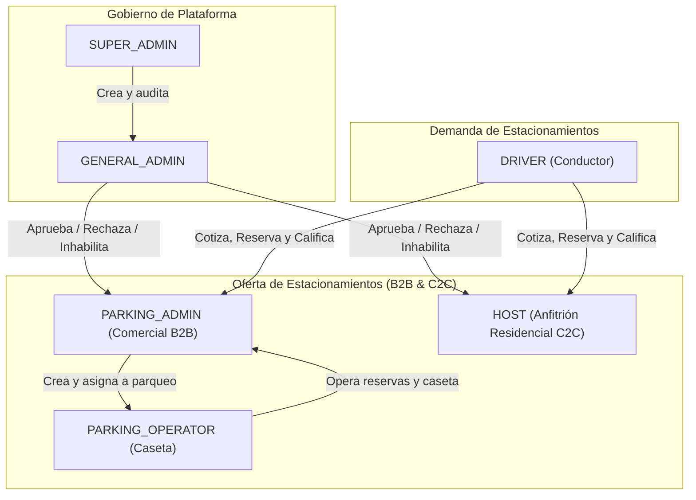
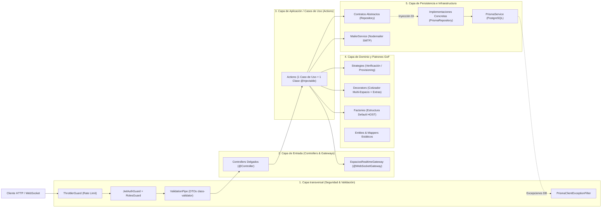
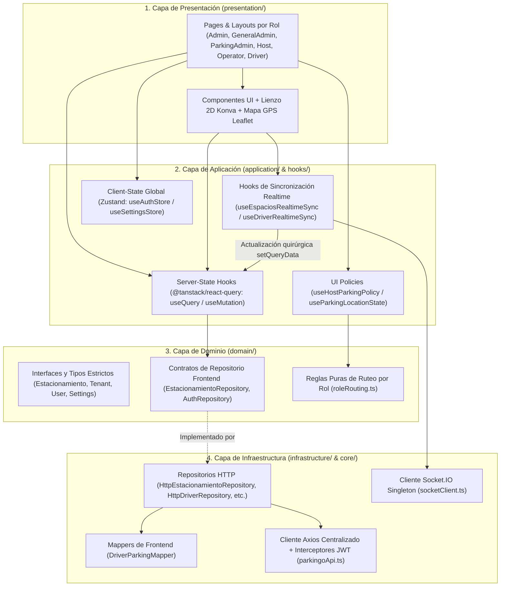

# Documentación Técnica y Funcional Integral — Sistema ParkinGo

> [!NOTE]
> Este documento constituye la especificación técnica, funcional, arquitectónica y de auditoría (seguridad, permisos y rendimiento) del ecosistema **ParkinGo**, conformado por el backend [parkingo-api](file:///d:/Chamba/ParkinGo/parkinGo/parkingo-api) (NestJS + Prisma + PostgreSQL + Socket.IO) y el frontend [parking-go-front](file:///d:/Chamba/ParkinGo/parkinGo/parking-go-front) (React 19 + TypeScript + Vite + Zustand + TanStack Query + Konva + Leaflet).

---

## Índice General

1. [Roles del Sistema y Modelo de Identidad](#1-roles-del-sistema-y-modelo-de-identidad)
2. [Funcionalidades Detalladas por Rol](#2-funcionalidades-detalladas-por-rol)
3. [Restricciones y Políticas de Acceso por Rol](#3-restricciones-y-políticas-de-acceso-por-rol)
4. [Catálogo Completo de Funcionalidades del Sistema](#4-catálogo-completo-de-funcionalidades-del-sistema)
5. [Auditoría Técnica: Rendimiento, Seguridad y Mejora de Permisos](#5-auditoría-técnica-rendimiento-seguridad-y-mejora-de-permisos)
6. [Arquitectura Implementada en el Backend (`parkingo-api`)](#6-arquitectura-implementada-en-el-backend-parkingo-api)
7. [Arquitectura Implementada en el Frontend (`parking-go-front`)](#7-arquitectura-implementada-en-el-frontend-parking-go-front)

---

## 1. Roles del Sistema y Modelo de Identidad

El sistema implementa un control de acceso híbrido basado en roles (**RBAC**) mediante los modelos `Role`, `Permission` y `User` definidos en [schema.prisma](file:///d:/Chamba/ParkinGo/parkinGo/parkingo-api/prisma/schema.prisma#L14-L86), complementado por políticas de propiedad de recursos (*Resource Ownership Policies*) y jerarquía de creación (`createdById`).

### 1.1. Roles Canónicos

| Rol Canónico (DB / API) | Alias Soportados en Frontend | Naturaleza del Actor | Ruta Principal Post-Login |
| :--- | :--- | :--- | :--- |
| **`SUPER_ADMIN`** | `ADMIN` | Ejecutivo / Propietario global de la plataforma ParkinGo. | `/dashboard/admin/reports` |
| **`GENERAL_ADMIN`** | — | Administrador operativo de plataforma (moderación, auditoría y soporte B2B/C2C). | `/dashboard/general-admin/reports` |
| **`PARKING_ADMIN`** | — | Administrador de Parqueo Comercial (B2B / Multi-nivel / Con personal de caseta). | `/dashboard/parking-admin/users` |
| **`HOST`** | `ANFITRION` | Anfitrión Particular (C2C / Garaje o cochera residencial unipersonal). | `/dashboard/parking-admin/estacionamiento` |
| **`PARKING_OPERATOR`** | `OPERATOR`, `OPERADOR` | Operador de Caseta / Control de piso asignado a un estacionamiento comercial. | `/dashboard/operator/profile` |
| **`DRIVER`** | `CONDUCTOR` | Conductor / Cliente final que busca, cotiza, reserva y califica parqueos. | `/dashboard` (`/dashboard/driver`) |

La normalización de roles en el cliente se centraliza en [roleRouting.ts](file:///d:/Chamba/ParkinGo/parkinGo/parking-go-front/src/modules/auth/domain/roleRouting.ts#L13-L54).

### 1.2. Estados del Usuario (`UserStatus`)

Definidos en [schema.prisma](file:///d:/Chamba/ParkinGo/parkinGo/parkingo-api/prisma/schema.prisma#L27-L33):
- **`ACTIVE`**: Usuario con acceso operativo completo según su rol.
- **`PENDING_APPROVAL`**: Socios comerciales (`PARKING_ADMIN` / `HOST`) que completaron el registro con respaldo documental PDF pero requieren validación o activación.
- **`INACTIVE`**: Cuenta desactivada temporalmente.
- **`SUSPENDED`**: Cuenta bloqueada por infracción de políticas.
- **`DELETED`**: Baja lógica del sistema.

---

## 2. Funcionalidades Detalladas por Rol



### 2.1. `SUPER_ADMIN` (Superadministrador)
Posee control total sobre la configuración estructural, analítica financiera y seguridad del sistema:
- **Analítica Ejecutiva y Financiera:** Consulta de KPIs globales, ingresos por comisiones, tarifas de servicio, planes contratados y series históricas en [ReportsController](file:///d:/Chamba/ParkinGo/parkinGo/parkingo-api/src/modules/reports/controllers/reports.controller.ts#L21-L31) (`GET /api/reports/general`) y [GeneralReportsPage.tsx](file:///d:/Chamba/ParkinGo/parkinGo/parking-go-front/src/modules/admin/presentation/pages/GeneralReportsPage.tsx).
- **Gestión de Roles y Matriz de Permisos (RBAC):** Creación, edición de permisos asociados y eliminación de roles en [RolesController](file:///d:/Chamba/ParkinGo/parkinGo/parkingo-api/src/modules/roles/controllers/roles.controller.ts#L48-L85) (`POST`, `PATCH`, `DELETE /api/roles`) y [RolesPermissionsPage.tsx](file:///d:/Chamba/ParkinGo/parkinGo/parking-go-front/src/modules/admin/presentation/pages/RolesPermissionsPage.tsx).
- **Gestión Global de Usuarios y Creación de `GENERAL_ADMIN`:** Único rol autorizado para registrar cuentas con rol `GENERAL_ADMIN` ([CreateUsuarioAction](file:///d:/Chamba/ParkinGo/parkinGo/parkingo-api/src/modules/usuarios/actions/create-usuario.action.ts#L39-L42)), además de listar, editar, aprobar o eliminar cualquier usuario.
- **Gobierno de Empresas (Tenants) y Solicitudes de Estacionamientos:** Visualización global de empresas, baja/reactivación, eliminación definitiva (`DELETE /api/tenants/:id`), y aprobación/rechazo/inhabilitación de estacionamientos (`PATCH /api/admin/estacionamientos/:id/*`).
- **Gestión de Términos y Condiciones:** Creación, actualización de versiones y eliminación de cláusulas legales en [ConfiguracionController](file:///d:/Chamba/ParkinGo/parkinGo/parkingo-api/src/modules/configuracion/controllers/configuracion.controller.ts).
- **Auditoría de Reservas:** Consulta de boletas de reserva de cualquier estacionamiento (`GET /api/reservas/estacionamiento/:id`).

### 2.2. `GENERAL_ADMIN` (Administrador General)
Orientado a la operación diaria, moderación de socios y soporte de la red de parqueos:
- **Auditoría y Moderación de Solicitudes de Parqueos:** Revisión de fichas técnicas, fotos, ubicación GPS, horarios y NIT de solicitudes `PENDIENTE`; ejecución de aprobación (`APROBADO`), rechazo con motivo (`RECHAZADO` + envío de email vía `MailerService`) e inhabilitación (`INHABILITADO`) en [AdminEstacionamientosController](file:///d:/Chamba/ParkinGo/parkinGo/parkingo-api/src/modules/estacionamientos/controllers/admin-estacionamientos.controller.ts#L36-L125) y [AdminSolicitudesEstacionamientosPage.tsx](file:///d:/Chamba/ParkinGo/parkinGo/parking-go-front/src/modules/estacionamientos/presentation/pages/AdminSolicitudesEstacionamientosPage.tsx).
- **Gestión de Empresas (Tenants):** Consulta global de tenants registrados, edición administrativa, baja/reactivación y eliminación definitiva en [TenantsController](file:///d:/Chamba/ParkinGo/parkinGo/parkingo-api/src/modules/tenants/controllers/tenants.controller.ts#L79-L167).
- **Moderación de Usuarios:** Listado global de usuarios, aprobación de cuentas pendientes (`UsersPendingApprovalTable.tsx`), edición y baja en [UsuariosController](file:///d:/Chamba/ParkinGo/parkinGo/parkingo-api/src/modules/usuarios/controllers/usuarios.controller.ts).
- **Gestión de Términos y Condiciones Legales:** Administración del catálogo legal en `/api/configuracion/terminos-condiciones`.

### 2.3. `PARKING_ADMIN` (Administrador de Parqueo Comercial — B2B)
Representa a empresas de estacionamiento comercial que operan infraestructura multi-nivel y personal de caseta:
- **Gestión de Empresas (`Tenants`):** Registro y administración de sus empresas con NIT, razón social, dirección y geolocalización ([TenantsManagementPage.tsx](file:///d:/Chamba/ParkinGo/parkinGo/parking-go-front/src/modules/tenants/presentation/pages/TenantsManagementPage.tsx)).
- **Gestión de Personal Operativo (`PARKING_OPERATOR`):** Creación de cuentas de operadores de caseta con despacho automático de credenciales por correo ([CreateUsuarioAction](file:///d:/Chamba/ParkinGo/parkinGo/parkingo-api/src/modules/usuarios/actions/create-usuario.action.ts#L49-L106)), edición, eliminación y asignación/desasignación a estacionamientos ([EstacionamientoOperadoresController](file:///d:/Chamba/ParkinGo/parkinGo/parkingo-api/src/modules/estacionamientos/controllers/estacionamiento-operadores.controller.ts)).
- **Ciclo de Vida del Estacionamiento:**
  - Registro de solicitud de estacionamiento comercial con galería fotográfica, coordenadas GPS y horarios ([RegistrarEstacionamientoAction](file:///d:/Chamba/ParkinGo/parkinGo/parkingo-api/src/modules/estacionamientos/actions/registrar-estacionamiento.action.ts)).
  - Eliminación y re-postulación en caso de solicitud rechazada ([EliminarEstacionamientoRechazadoAction](file:///d:/Chamba/ParkinGo/parkinGo/parkingo-api/src/modules/estacionamientos/actions/eliminar-estacionamiento-rechazado.action.ts)).
- **Infraestructura Física, Niveles, Espacios y Croquis 2D (Konva):**
  - Creación de múltiples pisos/niveles (`NivelesController`).
  - Creación ilimitada de espacios/boxes por tipo de vehículo (`AUTO`, `MOTO`, `CAMIONETA`, `DISCAPACITADO`, `ELECTRICO`), modalidad (`HORA`, `DIA`, `MES`) y estado (`DISPONIBLE`, `OCUPADO`, `RESERVADO`, `MANTENIMIENTO`) con difusión en tiempo real por WebSockets.
  - Diseño interactivo del plano arquitectónico 2D en lienzo Konva (`TenantCroquisPanel.tsx`) con carga de imagen de plano de fondo (`POST /api/estacionamientos/me/niveles/:nivelId/croquis/fondo-imagen`).
- **Configuración Comercial (Tarifas y Servicios Extras):**
  - Administración de tarifario (`HORA`, `DIA`, `MES`) en `TarifasController`.
  - Administración de servicios adicionales (lavado, carga eléctrica, valet, etc.) en `ServiciosExtrasController`.
- **Monitoreo de Reservas y Calificaciones:** Consulta de reservas recibidas en su parqueo (`GET /api/reservas/estacionamiento/:id`) y reseñas de clientes (`GET /api/calificaciones/tenant`).

### 2.4. `HOST` (Anfitrión Particular — C2C)
Propietario individual que alquila una cochera o garaje residencial particular bajo el modelo C2C:
- **Onboarding Guiado C2C (`HostOnboardingWizard.tsx`):** Flujo simplificado paso a paso para registrar su propiedad y publicar su espacio residencial.
- **Aprovisionamiento Automático Residencial (Patrón Strategy + Factory):** Al registrar su estacionamiento, el backend ejecuta [HostResidentialProvisioningStrategy](file:///d:/Chamba/ParkinGo/parkinGo/parkingo-api/src/modules/estacionamientos/strategies/host-residential-provisioning.strategy.ts) y [HostDefaultStructureFactory](file:///d:/Chamba/ParkinGo/parkinGo/parkingo-api/src/modules/estacionamientos/factories/host-default-structure.factory.ts), creando automáticamente su nivel único (`NIVEL-UNICO`), su único espacio (`ESPACIO-1`) y su croquis base sin requerir configuración arquitectónica compleja.
- **Autogestión de su Cochera:** Edición de horarios, fotos de la cochera, tarifas, servicios extras, consulta de reservas recibidas y calificaciones de conductores desde un layout dedicado ([HostSidebar.tsx](file:///d:/Chamba/ParkinGo/parkinGo/parking-go-front/src/modules/host/presentation/layouts/HostSidebar.tsx)).

### 2.5. `PARKING_OPERATOR` / `OPERATOR` (Operador de Caseta)
Personal operativo asignado por un `PARKING_ADMIN` a un estacionamiento comercial:
- **Operación de Reservas en Caseta:** Cotización (`POST /api/reservas/cotizar`), registro manual de reservas en caseta (`POST /api/reservas`), listado de reservas del estacionamiento al que está asignado (`GET /api/reservas/estacionamiento/:id`) y verificación de detalle/QR (`GET /api/reservas/:id`).
- **Gestión de su Perfil Operativo:** Consulta y edición de sus datos personales y reporte de incidencias (`ParkingOperatorProfilePage.tsx`, `OperatorReportModal.tsx`).

### 2.6. `DRIVER` (Conductor / Cliente Final)
Usuario consumidor de la plataforma:
- **Exploración Geoespacial y Catálogo en Tiempo Real:** Mapa interactivo GPS con Leaflet ([InteractiveGpsMap.tsx](file:///d:/Chamba/ParkinGo/parkinGo/parking-go-front/src/modules/driver/presentation/components/InteractiveGpsMap.tsx)), geolocalización del navegador (`useDriverGeolocation.ts`), barra de búsqueda estilo Airbnb (`AirbnbSearchBar.tsx`), filtros por etiquetas (`seguridad`, `cubierto`, `ev`) y visualización de plazas disponibles en tiempo real vía Socket.IO (`useDriverRealtimeSync.ts`).
- **Inspección de Ficha Técnica y Croquis en Vivo:** Consulta de fotos, horarios, tarifas, servicios extras y visualización en vivo del plano 2D del estacionamiento ([DriverCroquisViewer.tsx](file:///d:/Chamba/ParkinGo/parkinGo/parking-go-front/src/modules/driver/presentation/components/DriverCroquisViewer.tsx)) con selección interactiva de boxes disponibles.
- **Gestión de Flota Personal (`VehiculosModule`):** Registro de vehículos propios (placa única, tipo, modelo, color), selección de vehículo predeterminado y eliminación (`/api/vehiculos`).
- **Motor de Cotización y Reserva Multi-Espacio (`ReservasModule`):**
  - Cotización dinámica en memoria combinando múltiples espacios y múltiples servicios extras mediante el **Patrón Decorator** (`POST /api/reservas/cotizar`).
  - Creación transaccional de boleta de reserva con validación de colisiones horarias, generación de `codigoReserva` y `qrToken` (`POST /api/reservas`).
  - Consulta de historial (`GET /api/reservas/mis-reservas`) y cancelación de reservas propias (`PATCH /api/reservas/:id/cancelar`).
- **Calificaciones y Reseñas (`CalificacionesModule`):** Emisión de reseñas de 1 a 5 estrellas con comentario sobre estacionamientos visitados (`POST /api/calificaciones`) e historial de reseñas emitidas (`GET /api/calificaciones/mis-resenas`).

---

## 3. Restricciones y Políticas de Acceso por Rol

El sistema aplica restricciones tanto en la capa de **Guards/Controllers** como en **Actions de Dominio** (Backend) y **UI Policies / ProtectedRoutes** (Frontend):

### 3.1. Matriz de Restricciones Estrictas

| Rol | Restricciones de Negocio y Seguridad Aplicadas | Archivos que Aplican la Restricción |
| :--- | :--- | :--- |
| **`HOST` (Anfitrión C2C)** | • **Máximo 1 Tenant (Propiedad):** Bloqueado al intentar crear una segunda empresa.<br>• **Máximo 1 Estacionamiento:** 1 estacionamiento por tenant.<br>• **Máximo 1 Nivel y 1 Espacio:** `CrearNivelAction` y `CrearEspacioAction` rechazan cualquier intento de superar 1 nivel o 1 plaza.<br>• **Prohibición Total de Operadores:** No puede listar, crear, editar, eliminar ni asignar operadores (`403 Forbidden`).<br>• **Aislamiento de Perfil:** En `/api/usuarios/:id` solo puede consultar o editar su propio `userId`, y se le bloquea la modificación de `roleId` y `status`. | [useHostParkingPolicy.ts](file:///d:/Chamba/ParkinGo/parkinGo/parking-go-front/src/modules/host/application/useHostParkingPolicy.ts#L22-L43)<br>[create-tenant.action.ts](file:///d:/Chamba/ParkinGo/parkinGo/parkingo-api/src/modules/tenants/actions/create-tenant.action.ts)<br>[crear-espacio.action.ts](file:///d:/Chamba/ParkinGo/parkinGo/parkingo-api/src/modules/estacionamientos/actions/crear-espacio.action.ts)<br>[estacionamiento-operadores.controller.ts](file:///d:/Chamba/ParkinGo/parkinGo/parkingo-api/src/modules/estacionamientos/controllers/estacionamiento-operadores.controller.ts)<br>[update-usuario.action.ts](file:///d:/Chamba/ParkinGo/parkinGo/parkingo-api/src/modules/usuarios/actions/update-usuario.action.ts#L14-L48) |
| **`PARKING_ADMIN`** | • **Aislamiento Multi-Tenant:** Solo puede ver/editar sus propios Tenants y el estacionamiento asociado a su Tenant.<br>• **Restricción de Creación de Usuarios:** Solo puede crear usuarios con rol `PARKING_OPERATOR` / `OPERATOR` (no puede crear otros Admins ni Drivers).<br>• **Propiedad Jerárquica (`createdById`):** Solo puede listar, editar, eliminar o asignar a su parqueo aquellos operadores cuyo `createdById` coincida con su `userId`.<br>• **Eliminación de Parqueo:** Solo puede eliminar su solicitud de estacionamiento si el estado es `RECHAZADO` (no puede borrar parqueos `APROBADO` o `PENDIENTE`). | [create-usuario.action.ts](file:///d:/Chamba/ParkinGo/parkinGo/parkingo-api/src/modules/usuarios/actions/create-usuario.action.ts#L49-L53)<br>[get-usuarios.action.ts](file:///d:/Chamba/ParkinGo/parkinGo/parkingo-api/src/modules/usuarios/actions/get-usuarios.action.ts#L13-L18)<br>[delete-usuario.action.ts](file:///d:/Chamba/ParkinGo/parkinGo/parkingo-api/src/modules/usuarios/actions/delete-usuario.action.ts#L15-L19)<br>[eliminar-estacionamiento-rechazado.action.ts](file:///d:/Chamba/ParkinGo/parkinGo/parkingo-api/src/modules/estacionamientos/actions/eliminar-estacionamiento-rechazado.action.ts) |
| **`GENERAL_ADMIN`** | • **Sin Creación Manual de Cuentas:** Bloqueado en `POST /api/usuarios` (`Los administradores generales no tienen permiso para crear cuentas`).<br>• **Sin Mutación de Roles:** No puede crear, actualizar ni eliminar roles en `/api/roles` (exclusivo `SUPER_ADMIN`).<br>• **Privacidad de Reservas de Parqueos:** Bloqueado explícitamente en `GET /api/reservas/estacionamiento/:id` para impedir espionaje comercial de reservas operativas de un parqueo específico. | [create-usuario.action.ts](file:///d:/Chamba/ParkinGo/parkinGo/parkingo-api/src/modules/usuarios/actions/create-usuario.action.ts#L29-L32)<br>[roles.controller.ts](file:///d:/Chamba/ParkinGo/parkinGo/parkingo-api/src/modules/roles/controllers/roles.controller.ts#L48-L85)<br>[reservas.controller.ts](file:///d:/Chamba/ParkinGo/parkinGo/parkingo-api/src/modules/reservas/controllers/reservas.controller.ts#L111-L130) |
| **`PARKING_OPERATOR`** | • **Sin Acceso a Configuración de Infraestructura:** No puede modificar tarifas, horarios, niveles, croquis, fotos ni datos del Tenant.<br>• **Acceso a Reservas Acotado:** Solo puede consultar reservas del `estacionamientoId` al cual está asignado actualmente. | [router.tsx](file:///d:/Chamba/ParkinGo/parkinGo/parking-go-front/src/router.tsx#L90-L108)<br>[get-reservas-estacionamiento.action.ts](file:///d:/Chamba/ParkinGo/parkinGo/parkingo-api/src/modules/reservas/actions/get-reservas-estacionamiento.action.ts) |
| **`DRIVER`** | • **Solo Consumo y Autogestión:** No puede acceder a rutas administrativas (`/dashboard/parking-admin`, `/dashboard/admin`, `/dashboard/general-admin`, `/dashboard/operator`).<br>• **Propiedad de Vehículos y Reservas:** Solo puede cancelar reservas cuyo `clienteId` sea su propio `userId` y gestionar vehículos donde `propietarioId === userId`. | [ProtectedRoute.tsx](file:///d:/Chamba/ParkinGo/parkinGo/parking-go-front/src/modules/auth/presentation/components/ProtectedRoute.tsx)<br>[cancelar-reserva.action.ts](file:///d:/Chamba/ParkinGo/parkinGo/parkingo-api/src/modules/reservas/actions/cancelar-reserva.action.ts) |

---

## 4. Catálogo Completo de Funcionalidades del Sistema

El sistema se organiza en **11 módulos funcionales de dominio**:

### 4.1. Módulo de Autenticación y Verificación (`auth`)
- **Login JWT (`POST /api/auth/login`):** Validación de credenciales con `bcrypt`, verificación de estado de cuenta y emisión de token JWT firmado.
- **Registro Inteligente con Estrategias de Verificación (`POST /api/auth/register`):**
  - Validación de correos desechables y comprobación DNS de registros **MX** reales ([EmailValidatorUtil](file:///d:/Chamba/ParkinGo/parkinGo/parkingo-api/src/modules/auth/utils/email-validator.util.ts)).
  - **Patrón Strategy** ([UserVerificationContext](file:///d:/Chamba/ParkinGo/parkinGo/parkingo-api/src/modules/auth/strategies/verification/user-verification.context.ts)):
    - `StandardDriverStrategy`: Registro directo para conductores (`DRIVER`) con activación por OTP.
    - `DocumentedPartnerStrategy`: Para `PARKING_ADMIN` y `HOST`, exige documento PDF probatorio (máx. 10 MB, validado en `UserVerificationDocument`) y asigna estado inicial controlado.
- **Verificación y Reenvío OTP (`POST /api/auth/verify-otp`, `POST /api/auth/resend-otp`):** Código OTP de 6 dígitos hasheado en base de datos (`EmailVerificationToken`), control de intentos máximos y *cooldown* de 60 segundos para reenvíos.

### 4.2. Módulo de Usuarios (`usuarios`)
- CRUD jerárquico de usuarios, aislamiento por `createdById`, validación de unicidad de `email` y `ci` (Cédula de Identidad), y envío de correo de bienvenida con contraseña temporal para operadores de caseta recién creados.

### 4.3. Módulo de Roles y Permisos (`roles`)
- Gestión dinámica de roles (`Role`) y permisos (`Permission`) mediante relación muchos-a-muchos en PostgreSQL.

### 4.4. Módulo de Configuración Legal (`configuracion`)
- Publicación pública (`GET /api/configuracion/terminos-condiciones`) y administración protegida (`POST`, `PATCH`, `DELETE`) de cláusulas de Términos y Condiciones con control de orden y versión (`TerminoCondicion`).

### 4.5. Módulo de Empresas / Propiedades (`tenants`)
- Gestión del perfil jurídico/comercial (`Tenant`): nombre comercial, NIT único, razón social, dirección, ciudad, coordenadas (`latitud`, `longitud`), horarios corporativos y estado (`ACTIVO` / `INACTIVO`), con notificación por correo electrónico al registrar la empresa.

### 4.6. Módulo de Estacionamientos, Croquis y Operadores (`estacionamientos`)
Es el núcleo operativo de oferta del sistema y abarca **7 controladores especializados**:
1. **`EstacionamientosController`:** Registro multipart con subida de hasta 10 fotos, consulta de `/me`, actualización de horarios, gestión de galería fotográfica, eliminación de solicitudes rechazadas y exposición del catálogo público/conductor (`/api/estacionamientos/catalogo`).
2. **`AdminEstacionamientosController`:** Flujo de moderación (listar por estado, aprobar, rechazar con motivo y notificación por email, inhabilitar).
3. **`TenantHorariosController`:** Configuración de horarios de apertura y cierre por día de la semana (`LUNES` a `DOMINGO`) a nivel Tenant y sincronización con el estacionamiento.
4. **`NivelesController`:** Gestión de niveles/pisos del parqueo (`Nivel`).
5. **`EspaciosController`:** Gestión de boxes/plazas (`Espacio`) por tipo, modalidad tarifaria y estado operativo, disparando eventos de sincronización en tiempo real tras cada creación, edición o eliminación.
6. **`CroquisController`:** Persistencia y consulta de planos 2D (`Croquis`) en formato JSON (dimensiones de lienzo, nodos de espacios, carriles, muros, entradas/salidas) y subida de planos arquitectónicos de fondo (`fondoImagenUrl`, `fondoOpacidad`).
7. **`TarifasController` y `ServiciosExtrasController`:** CRUD completo de tarifas (`HORA`, `DIA`, `MES`) y servicios adicionales configurables.
8. **`EstacionamientoOperadoresController`:** Asignación y desasignación de operadores de caseta a estacionamientos comerciales.

### 4.7. Módulo de Sincronización en Tiempo Real (`realtime`)
- Implementado con **Socket.IO** en el namespace `/realtime` ([EspaciosRealtimeGateway](file:///d:/Chamba/ParkinGo/parkinGo/parkingo-api/src/modules/realtime/gateways/espacios-realtime.gateway.ts)).
- Maneja salas (*rooms*) segmentadas:
  - `catalogo:espacios`: Recibe actualizaciones globales de disponibilidad para las tarjetas y el mapa del `DRIVER`.
  - `parking:${estacionamientoId}`: Sincroniza instantáneamente el lienzo Konva (`DriverCroquisViewer` y `TenantCroquisPanel`) cuando un espacio cambia de estado (`DISPONIBLE`, `OCUPADO`, `RESERVADO`, `MANTENIMIENTO`), se crea o se elimina.
- En el frontend, [useEspaciosRealtimeSync.ts](file:///d:/Chamba/ParkinGo/parkinGo/parking-go-front/src/modules/estacionamientos/application/useEspaciosRealtimeSync.ts) y [useDriverRealtimeSync.ts](file:///d:/Chamba/ParkinGo/parkinGo/parking-go-front/src/modules/driver/application/useDriverRealtimeSync.ts) actualizan quirúrgicamente la caché de `@tanstack/react-query` (`setQueryData`) sin recargar toda la pantalla.

### 4.8. Módulo de Reservas y Cotización Dinámica (`reservas`)
- **Motor de Precios con Patrón Decorator ([src/modules/reservas/domain/decorator/](file:///d:/Chamba/ParkinGo/parkinGo/parkingo-api/src/modules/reservas/domain/decorator/reserva-price.assembler.ts)):**
  - `ReservableComponent` (Interfaz base) → `EspacioReservadoComponent` (Componente concreto que calcula tarifa base × duración según modalidad `HORA`, `DIA`, `MES`) → `ServicioExtraDecorator` (Decorador genérico apilable recursivamente para N servicios extras sin explosión de subclases).
- **Control Transaccional de Colisiones:** Verifica solapamiento de intervalos `[inicioReserva, finReserva)` antes de confirmar la reserva, almacena *snapshots* inmutables de precios (`precioUnitarioAplicado`) y genera token QR.

### 4.9. Módulo de Vehículos (`vehiculos`)
- Registro de vehículos del conductor, validación de placa única y marca de vehículo predeterminado para agilizar el *checkout* de reservas.

### 4.10. Módulo de Calificaciones y Reputación (`calificaciones`)
- Creación de reseñas verificadas, cálculo de promedio de estrellas, distribución por puntaje y listado por estacionamiento o por tenant.

### 4.11. Módulo de Reportes (`reports`), Correo (`mailer`) y Preferencias UI (`settings`)
- **Reportes:** Analítica consolidada para `SUPER_ADMIN`.
- **Mailer (`MailerService`):** Envío SMTP con plantillas HTML para códigos OTP, bienvenida de operadores, confirmación de registro de empresa y notificación de rechazo de estacionamiento.
- **Settings UI (Frontend):** Motor de temas (`light`, `dark`, `system`) y escala tipográfica accesible (`sm`, `md`, `lg`, `xl`) persistido en `localStorage` con Zustand ([useSettingsStore.ts](file:///d:/Chamba/ParkinGo/parkinGo/parking-go-front/src/store/useSettingsStore.ts)).

---

## 5. Auditoría Técnica: Rendimiento, Seguridad y Mejora de Permisos

A continuación se presenta el diagnóstico exhaustivo basado en la inspección directa del código fuente actual, clasificado por criticidad.

> [!CAUTION]
> **Hallazgos Críticos de Seguridad y Permisos que deben corregirse prioritariamente:**
> 1. Posible escalación de privilegios e IDOR en `PATCH /api/usuarios/:id` y `GET /api/usuarios/:id`.
> 2. Exposición pública sin autenticación de documentos PDF de verificación en `/uploads/verification_documents/`.
> 3. Desajuste de tipado en `@CurrentUser()` dentro de `TenantHorariosController` que anula el paso de roles hacia la capa Action.

### 5.1. Revisión de Permisos y Control de Acceso (RBAC / ABAC)

#### 1. Vulnerabilidad de Escalación de Privilegios e IDOR en `UsuariosController` y `UpdateUsuarioAction` (CRÍTICO)
- **Ubicación:** [usuarios.controller.ts](file:///d:/Chamba/ParkinGo/parkinGo/parkingo-api/src/modules/usuarios/controllers/usuarios.controller.ts#L55-L92), [get-usuario.action.ts](file:///d:/Chamba/ParkinGo/parkinGo/parkingo-api/src/modules/usuarios/actions/get-usuario.action.ts#L8-L13) y [update-usuario.action.ts](file:///d:/Chamba/ParkinGo/parkinGo/parkingo-api/src/modules/usuarios/actions/update-usuario.action.ts#L10-L54).
- **Problema:**
  1. `GET /api/usuarios/:id` y `PATCH /api/usuarios/:id` no tienen decorador `@Roles(...)` en el controlador (para permitir que cualquier usuario edite su propio perfil).
  2. Sin embargo, en `GetUsuarioAction` y `UpdateUsuarioAction`, **solo** se valida propiedad cuando `requestingRoleName === 'HOST'` o `requestingRoleName === 'PARKING_ADMIN'`. Si el usuario autenticado es `DRIVER` o `PARKING_OPERATOR`, no existe validación `id !== requestingUserId`, permitiéndoles leer o modificar perfiles de terceros (IDOR / BOLA).
  3. Además, en `UpdateUsuarioAction` (líneas 45-48), `delete dataToUpdate.roleId` y `delete dataToUpdate.status` **solo se ejecutan si `requestingRoleName === 'HOST'`**. Un `DRIVER`, `PARKING_OPERATOR` o `PARKING_ADMIN` que envíe `PATCH /api/usuarios/:suPropioId` con `{ "roleId": "<UUID_SUPER_ADMIN>" }` (obtenible desde `GET /api/roles`, que tampoco tiene `@Roles`) puede escalar su cuenta a `SUPER_ADMIN`.
- **Solución recomendada:**
  - En `GetUsuarioAction` y `UpdateUsuarioAction`, exigir que si `requestingRoleName` no es `SUPER_ADMIN` ni `GENERAL_ADMIN` (ni `PARKING_ADMIN` operando sobre un operador con `createdById === requestingUserId`), obligatoriamente se cumpla `id === requestingUserId`.
  - Bloquear la modificación de `roleId` y `status` para **todos** los roles excepto `SUPER_ADMIN` (y `GENERAL_ADMIN` solo para `status`).
  - Restringir `GET /api/roles` con `@Roles('SUPER_ADMIN', 'GENERAL_ADMIN', 'PARKING_ADMIN')`.

#### 2. Bug de Estructura de `@CurrentUser()` en `TenantHorariosController` (ALTO)
- **Ubicación:** [tenant-horarios.controller.ts](file:///d:/Chamba/ParkinGo/parkinGo/parkingo-api/src/modules/estacionamientos/controllers/tenant-horarios.controller.ts#L50-L85).
- **Problema:** El controlador declara `@CurrentUser() user: { userId: string; role?: { name: string } }` y pasa `user.role?.name ? [user.role.name] : []` al Action. Sin embargo, [jwt.strategy.ts](file:///d:/Chamba/ParkinGo/parkinGo/parkingo-api/src/modules/auth/strategies/jwt.strategy.ts#L24-L31) devuelve `role: role.name` (un `string`) y `roleName: role.name`. Como un `string` no tiene la propiedad `.name`, `user.role?.name` siempre es `undefined` y el Action recibe `[]` como lista de roles, impidiendo que `SUPER_ADMIN` o `GENERAL_ADMIN` sean reconocidos como administradores dentro de `GetTenantHorariosAction` y `ActualizarTenantHorariosAction`.
- **Solución recomendada:** Estandarizar una interfaz `AuthenticatedUser` global en `src/modules/auth/interfaces/authenticated-user.interface.ts` y usar `user.roleName` en `TenantHorariosController`.

#### 3. Inconsistencia entre Rutas de Reportes en Frontend y Backend para `GENERAL_ADMIN` (MEDIO)
- **Ubicación:** [router.tsx](file:///d:/Chamba/ParkinGo/parkinGo/parking-go-front/src/router.tsx#L118-L123) vs [reports.controller.ts](file:///d:/Chamba/ParkinGo/parkinGo/parkingo-api/src/modules/reports/controllers/reports.controller.ts#L21).
- **Problema:** En el frontend, la ruta por defecto de `GENERAL_ADMIN` (`/dashboard/general-admin`) redirige a `/dashboard/general-admin/reports` que monta `GeneralReportsPage`. Sin embargo, en el backend `GET /api/reports/general` tiene `@Roles('SUPER_ADMIN')`, devolviendo `403 Forbidden` a `GENERAL_ADMIN`. Asimismo, en `backend_graph.json` figura como `/reports/general-analytics` mientras el endpoint real es `/reports/general`.
- **Solución recomendada:** Incluir `'GENERAL_ADMIN'` en `@Roles('SUPER_ADMIN', 'GENERAL_ADMIN')` de `ReportsController` (o redirigir el índice de `GENERAL_ADMIN` a `/dashboard/general-admin/solicitudes`) y sincronizar `backend_graph.json`.

#### 4. Desaprovechamiento de la Tabla `Permission` en `RolesGuard` (MEDIO)
- **Ubicación:** [roles.guard.ts](file:///d:/Chamba/ParkinGo/parkinGo/parkingo-api/src/modules/auth/guards/roles.guard.ts).
- **Problema:** Aunque la base de datos y el módulo `roles` gestionan permisos granulares (`Permission` asociados a `Role`), `RolesGuard` solo verifica nombres estáticos de rol (`@Roles('PARKING_ADMIN', ...)`). Si desde la UI de `RolesPermissionsPage` el `SUPER_ADMIN` crea un rol personalizado o modifica los permisos de un rol existente, los endpoints no reflejan esos permisos dinámicos.
- **Solución recomendada:** Crear un `@RequirePermissions('...')` y `PermissionsGuard` que evalúe los permisos asignados al rol del usuario en sesión.

---

### 5.2. Revisión de Seguridad (AppSec & Infraestructura)

#### 1. Exposición Pública de Documentos de Verificación en `/uploads` (CRÍTICO)
- **Ubicación:** [main.ts](file:///d:/Chamba/ParkinGo/parkinGo/parkingo-api/src/main.ts#L15-L17).
- **Problema:** `app.useStaticAssets(path.join(process.cwd(), 'uploads'), { prefix: '/uploads' })` sirve de forma pública e irrestricta toda la carpeta `uploads/`. Mientras que `uploads/estacionamientos/` contiene fotos públicas de parqueos, `uploads/verification_documents/` almacena documentos legales sensibles (PDFs de NIT, carnets de identidad, boletas de inscripción).
- **Solución recomendada:** Servir públicamente únicamente `uploads/estacionamientos` y `uploads/croquis`, y mover `uploads/verification_documents` detrás de un endpoint protegido con `JwtAuthGuard` y `@Roles('SUPER_ADMIN', 'GENERAL_ADMIN')` (o propietario del documento).

#### 2. WebSocket Gateway (`/realtime`) sin Autenticación JWT (MEDIO)
- **Ubicación:** [espacios-realtime.gateway.ts](file:///d:/Chamba/ParkinGo/parkinGo/parkingo-api/src/modules/realtime/gateways/espacios-realtime.gateway.ts#L76-L115).
- **Problema:** Cualquier cliente externo que conozca la URL del servidor puede conectarse al namespace `/realtime` y suscribirse a `room:join-catalogo` o `room:join-parking` sin presentar un token JWT válido.
- **Solución recomendada:** Validar `client.handshake.auth.token` o el header `Authorization` dentro de `handleConnection(client: Socket)` usando `JwtService.verifyAsync()`, desconectando sockets no autenticados si el negocio requiere que el catálogo sea solo para usuarios registrados.

#### 3. Validación de Estado de Cuenta en `JwtStrategy` y Almacenamiento de Token (MEDIO)
- **Ubicación:** [jwt.strategy.ts](file:///d:/Chamba/ParkinGo/parkinGo/parkingo-api/src/modules/auth/strategies/jwt.strategy.ts#L20-L32) y [parkingoApi.ts](file:///d:/Chamba/ParkinGo/parkinGo/parking-go-front/src/core/api/parkingoApi.ts#L19).
- **Problema:**
  - `JwtStrategy.validate()` verifica que el `roleId` exista, pero **no verifica** si el usuario (`payload.sub`) fue cambiado a estado `SUSPENDED`, `INACTIVE` o `DELETED` después de emitido el JWT. Un usuario suspendido puede seguir operando hasta que expire su JWT.
  - En el frontend, el token JWT se almacena en `localStorage` (`parkingo_token`), lo que lo expone en caso de vulnerabilidad XSS.
- **Solución recomendada:** Verificar el `status === 'ACTIVE'` del usuario en `JwtStrategy` (o mediante caché de corta duración / lista de revocación) e implementar `refreshToken` en cookie `HttpOnly` con `accessToken` de corta vida.

#### 4. Validación de Magic Bytes en Subida de Archivos (BAJO)
- **Ubicación:** `SubirFotosAction`, `RegistrarEstacionamientoAction`, `SubirFondoCroquisAction`.
- **Problema:** La validación de archivos se apoya principalmente en extensión/MIME declarado por el cliente (`mimetype`).
- **Solución recomendada:** Validar la firma binaria (*magic bytes*: `FF D8 FF` para JPEG, `89 50 4E 47` para PNG, `52 49 46 46` para WebP, `25 50 44 46` para PDF) antes de escribir en disco.

---

### 5.3. Revisión de Rendimiento (Performance Backend & Frontend)

#### 1. Límite Global de Rate Limiting (`ThrottlerGuard`) Demasiado Restrictivo para una SPA (ALTO)
- **Ubicación:** [app.module.ts](file:///d:/Chamba/ParkinGo/parkinGo/parkingo-api/src/app.module.ts#L35-L44).
- **Problema:** `ThrottlerModule.forRoot([{ ttl: 60000, limit: 20 }])` limita toda la API a **20 peticiones por minuto por IP**. Cuando un `PARKING_ADMIN` o `DRIVER` navega por el dashboard, TanStack Query lanza en paralelo entre 5 y 8 consultas (`estacionamientos/me`, `niveles`, `espacios`, `tarifas`, `servicios`, `croquis`, `tenants`). En apenas 3 cambios de vista o ediciones en el lienzo Konva dentro del mismo minuto, el usuario recibe errores **`429 Too Many Requests`**.
- **Solución recomendada:**
  - Incrementar el límite global para lectura/API general (ej. `limit: 120` por `ttl: 60000`).
  - Aplicar decoradores `@Throttle({ default: { limit: 5, ttl: 60000 } })` específicamente en endpoints sensibles a fuerza bruta o abuso (`/auth/login`, `/auth/register`, `/auth/verify-otp`, `/auth/resend-otp`).

#### 2. Consulta Repetitiva a Base de Datos en `JwtStrategy.validate` (MEDIO)
- **Ubicación:** [jwt.strategy.ts](file:///d:/Chamba/ParkinGo/parkinGo/parkingo-api/src/modules/auth/strategies/jwt.strategy.ts#L20-L22).
- **Problema:** En cada petición HTTP autenticada, `JwtStrategy` ejecuta `await this.roleRepository.findById(payload.roleId)` contra PostgreSQL. Dado que los roles (`SUPER_ADMIN`, `PARKING_ADMIN`, `HOST`, `DRIVER`, etc.) rara vez cambian de nombre, esto añade una consulta SQL extra a **todas** las requests de la API.
- **Solución recomendada:** Incluir `roleName` firmado dentro del payload del JWT al momento del login o cachear el mapa `roleId -> roleName` en memoria en `RoleRepository` con invalidación al editar roles.

#### 3. Sobrecarga de Relaciones en `findCatalogo()` sin Paginación ni Filtro Geoespacial (MEDIO)
- **Ubicación:** [listar-estacionamientos-catalogo.action.ts](file:///d:/Chamba/ParkinGo/parkinGo/parkingo-api/src/modules/estacionamientos/actions/listar-estacionamientos-catalogo.action.ts) y `PrismaEstacionamientoRepository.findCatalogo()`.
- **Problema:** `GET /api/estacionamientos/catalogo` trae en una sola consulta todos los estacionamientos aprobados junto con todas sus relaciones anidadas (`fotos`, `horarios`, `tarifas`, `serviciosExtras`, `niveles` y todos los `espacios` de cada nivel) y calcula conteos en memoria en Node.js. A medida que crezca el número de parqueos y plazas, el payload JSON y la memoria consumida crecerán linealmente.
- **Solución recomendada:** Añadir paginación o filtrado por *bounding box* geográfico (`latMin`, `latMax`, `lngMin`, `lngMax`) y devolver en el listado general solo el resumen de disponibilidad, cargando el detalle de `espacios` bajo demanda al abrir la ficha técnica o el croquis.

#### 4. Ausencia de Code-Splitting (`React.lazy`) y Tamaño del Bundle en Frontend (ALTO)
- **Ubicación:** [router.tsx](file:///d:/Chamba/ParkinGo/parkinGo/parking-go-front/src/router.tsx#L1-L23) y [vite.config.ts](file:///d:/Chamba/ParkinGo/parkinGo/parking-go-front/vite.config.ts).
- **Problema:**
  - Todas las páginas y layouts de los 6 roles se importan de forma estática en `src/router.tsx`.
  - Como resultado, `vite build` genera un único archivo JavaScript monolítico de **2,124.85 kB** (`602.94 kB` gzip). Un conductor (`DRIVER`) o visitante en la `LandingPage` descarga el editor de croquis Konva del `PARKING_ADMIN`, las gráficas `Chart.js` del `SUPER_ADMIN` y todas las tablas administrativas en la carga inicial.
  - Además, las imágenes en `src/assets/` (`Vehiculo.png` de **1.91 MB**, 6 imágenes `parking_*.png` de **1.03 MB a 1.17 MB** cada una) están en formato PNG sin comprimir (más de **9.5 MB** en imágenes estáticas).
- **Solución recomendada:**
  - Implementar `lazy()` y `<Suspense>` por ruta/rol en `src/router.tsx` y configurar `manualChunks` / `codeSplitting` en `vite.config.ts` para separar `konva`, `leaflet` y `chart.js`.
  - Convertir los assets PNG de la landing page a **WebP / AVIF** (reducción estimada del 85% en peso de imágenes).
  - En `vite.config.ts`, restringir `@rolldown/plugin-babel` con `reactCompilerPreset()` únicamente a componentes/hooks de presentación o activar modo `annotation`, ya que actualmente consume el **89% del tiempo de compilación** (9.9s de 11.1s).

---

## 6. Arquitectura Implementada en el Backend (`parkingo-api`)

El backend está construido sobre **NestJS 11**, **TypeScript**, **Prisma ORM** y **PostgreSQL**, siguiendo una **Arquitectura Modular por Capas orientada a Acciones (Action-Based Modular Architecture / Clean Layered Architecture)** combinada con patrones de diseño GoF (**Strategy**, **Factory**, **Decorator**, **Repository** y **Mapper**).

### 6.1. Diagrama de Arquitectura por Capas del Backend



### 6.2. Anatomía de un Módulo en `parkingo-api`

Cada módulo dentro de `parkingo-api/src/modules/<modulo>/` respeta una separación estricta de responsabilidades (documentada también en [backend_graph.json](file:///d:/Chamba/ParkinGo/parkinGo/parkingo-api/backend_graph.json)):

1. **`controllers/` (Controladores Delgados):**
   - Solo gestionan metadatos HTTP (`@Get`, `@Post`, `@Patch`, `@Delete`), documentación OpenAPI/Swagger (`@ApiTags`, `@ApiOperation`, `@ApiResponse`), guards (`@UseGuards(JwtAuthGuard, RolesGuard)`, `@Roles(...)`) y pipes (`ParseUUIDPipe`).
   - No contienen lógica de negocio; delegan inmediatamente al método `.execute(...)` del `Action` correspondiente.
2. **`actions/` (Principio de Responsabilidad Única — 1 Caso de Uso = 1 Archivo Action):**
   - Cada operación de negocio vive en su propia clase inyectable (ej. [crear-espacio.action.ts](file:///d:/Chamba/ParkinGo/parkinGo/parkingo-api/src/modules/estacionamientos/actions/crear-espacio.action.ts), [cotizar-reserva.action.ts](file:///d:/Chamba/ParkinGo/parkinGo/parkingo-api/src/modules/reservas/actions/cotizar-reserva.action.ts)).
   - Orquesta reglas de dominio, validaciones de propiedad (multi-tenancy), llamadas a repositorios, envío de correos y emisión de eventos WebSocket.
3. **`repositories/` (Inversión de Dependencias — Ports & Adapters en Persistencia):**
   - Define una clase abstracta como contrato (ej. [estacionamiento.repository.ts](file:///d:/Chamba/ParkinGo/parkinGo/parkingo-api/src/modules/estacionamientos/repositories/estacionamiento.repository.ts)) y una implementación concreta con Prisma (ej. [prisma-estacionamiento.repository.ts](file:///d:/Chamba/ParkinGo/parkinGo/parkingo-api/src/modules/estacionamientos/repositories/prisma-estacionamiento.repository.ts)).
   - En el `.module.ts`, se registra mediante `{ provide: EstacionamientoRepository, useClass: PrismaEstacionamientoRepository }`, desacoplando los `Actions` del ORM.
4. **`dto/` (Validación de Entrada y Contratos de Salida):**
   - Validación declarativa estricta con `class-validator` y transformación con `class-transformer` bajo un `ValidationPipe` global con `whitelist: true` y `forbidNonWhitelisted: true`.
5. **`mappers/` y `entities/`:**
   - Clases con métodos estáticos puros (`Mapper.toResponse()`, `Mapper.toEntity()`) que transforman registros de Prisma en entidades de dominio o DTOs de respuesta sin exponer campos sensibles (como hashes de contraseñas).

### 6.3. Patrones de Diseño GoF Implementados en el Backend

| Patrón GoF | Dónde se aplica | Propósito Técnico |
| :--- | :--- | :--- |
| **Strategy** | 1. `src/modules/auth/strategies/verification/`<br>2. `src/modules/estacionamientos/strategies/` | 1. Diferenciar el flujo de registro entre conductores (`StandardDriverStrategy`) y socios con respaldo documental PDF (`DocumentedPartnerStrategy`).<br>2. Diferenciar el aprovisionamiento al crear un estacionamiento comercial (`CommercialParkingProvisioningStrategy`) vs. un garaje residencial C2C (`HostResidentialProvisioningStrategy`). |
| **Decorator** | `src/modules/reservas/domain/decorator/` | Calcular dinámicamente el precio y desglose de reservas multi-espacio envolviendo cada `EspacioReservadoComponent` con múltiples instancias recursivas de `ServicioExtraDecorator` (`ReservaPriceAssembler`). |
| **Factory** | `src/modules/estacionamientos/factories/host-default-structure.factory.ts` | Construir la estructura inicial por defecto (1 Nivel, 1 Espacio y 1 Croquis base) para anfitriones `HOST`. |
| **Repository** | Todos los módulos (`usuarios`, `roles`, `tenants`, `estacionamientos`, `reservas`, `vehiculos`, `calificaciones`) | Aislar las consultas de Prisma detrás de contratos abstractos inyectables. |

---

## 7. Arquitectura Implementada en el Frontend (`parking-go-front`)

El frontend es una **Single Page Application (SPA)** desarrollada con **React 19**, **TypeScript 6**, **Vite 8**, **React Router 8**, **Zustand 5**, **TanStack Query v5** y **Axios**, estructurada bajo **Arquitectura Limpia por Capas y Módulos Funcionales (Feature-Sliced / Clean Layered Architecture)**.

### 7.1. Diagrama de Arquitectura del Frontend



### 7.2. Organización de Directorios y Capas

```text
parking-go-front/src/
├── core/                           # Infraestructura transversal compartida
│   ├── api/parkingoApi.ts          # Instancia Axios única + interceptores Bearer JWT y manejo de 401
│   ├── auth/clearBrowserSessionData.ts # Limpieza atómica de sesión y caché
│   ├── query/queryClient.ts        # Instancia compartida de QueryClient (TanStack Query)
│   ├── realtime/                   # Cliente Socket.IO singleton y constantes de eventos/salas
│   └── services/                   # Servicios transversales (ej. geocodificación inversa)
├── store/                          # Estado global de cliente (Zustand con persistencia)
│   ├── useAuthStore.ts             # Sesión autenticada, usuario activo, token y flujo OTP pendiente
│   └── useSettingsStore.ts         # Tema visual (light/dark/system) y escala de fuente (sm/md/lg/xl)
├── modules/                        # Módulos de negocio desacoplados (Vertical Slices)
│   ├── auth/                       # Login, Registro, OTP, ProtectedRoute, roleRouting
│   ├── admin/                      # Vistas y tablas de SUPER_ADMIN (Reportes, Usuarios, Roles)
│   ├── general-admin/              # Layout y navegación de GENERAL_ADMIN
│   ├── parking-admin/              # Layout adaptable (B2B/C2C) y gestión de operadores
│   ├── host/                       # Onboarding Wizard C2C, HostSidebar y useHostParkingPolicy
│   ├── parking-operator/           # Layout y vistas de operador de caseta
│   ├── tenants/                    # Gestión de empresas, mapas de ubicación y formularios
│   ├── estacionamientos/           # Gestión integral de parqueo, niveles, espacios, tarifas, fotos y Croquis Konva
│   ├── driver/                     # Dashboard del conductor, mapa GPS Leaflet, buscador, croquis en vivo y reservas
│   ├── settings/                   # Modal y hooks de personalización de interfaz
│   └── landing/                    # Página pública promocional
└── router.tsx                      # Definición declarativa de rutas y guardas por rol
```

### 7.3. Gestión Dual del Estado y Sincronización en Tiempo Real

1. **Client-State Global (`Zustand`):**
   - Reservado exclusivamente para estado de sesión ([useAuthStore.ts](file:///d:/Chamba/ParkinGo/parkinGo/parking-go-front/src/store/useAuthStore.ts)) y preferencias de interfaz ([useSettingsStore.ts](file:///d:/Chamba/ParkinGo/parkinGo/parking-go-front/src/store/useSettingsStore.ts)).
   - Al cerrar sesión o recibir un `401 Unauthorized`, se invoca [clearBrowserSessionData.ts](file:///d:/Chamba/ParkinGo/parkinGo/parking-go-front/src/core/auth/clearBrowserSessionData.ts) que limpia tanto `localStorage` como toda la caché en memoria de `queryClient` para evitar fugas de datos entre sesiones de distintos usuarios/roles.
2. **Server-State (`@tanstack/react-query`):**
   - Todas las lecturas y escrituras remotas se encapsulan en custom hooks dentro de `application/` (ej. [useDriverQueries.ts](file:///d:/Chamba/ParkinGo/parkinGo/parking-go-front/src/modules/driver/application/useDriverQueries.ts), [useEspaciosQuery.ts](file:///d:/Chamba/ParkinGo/parkinGo/parking-go-front/src/modules/estacionamientos/application/useEspaciosQuery.ts), [useEstacionamientosMutations.ts](file:///d:/Chamba/ParkinGo/parkinGo/parking-go-front/src/modules/estacionamientos/application/useEstacionamientosMutations.ts)).
3. **Actualización Quirúrgica de Caché por WebSockets (`Socket.IO` + `React Query`):**
   - Cuando un espacio cambia de estado en el backend, el evento `espacio:actualizado` es procesado por [espaciosCacheUpdater.ts](file:///d:/Chamba/ParkinGo/parkinGo/parking-go-front/src/modules/estacionamientos/application/espaciosCacheUpdater.ts) y [parkingCacheUpdater.ts](file:///d:/Chamba/ParkinGo/parkinGo/parking-go-front/src/modules/driver/application/parkingCacheUpdater.ts), mutando de forma inmutable las entradas correspondientes en `queryClient` para que tanto el mapa del conductor como el croquis 2D reflejen el cambio en milisegundos sin hacer *polling* HTTP.
4. **Layout Polimórfico B2B / C2C:**
   - [ParkingAdminLayout.tsx](file:///d:/Chamba/ParkinGo/parkinGo/parking-go-front/src/modules/parking-admin/presentation/layouts/ParkingAdminLayout.tsx) detecta mediante `isHostRole(user?.role)` si el usuario autenticado es un `HOST` (Anfitrión C2C) o un `PARKING_ADMIN` (Comercial B2B), renderizando dinámicamente `HostSidebar` o `ParkingAdminSidebar` y aplicando las restricciones de `useHostParkingPolicy` sobre los mismos componentes reutilizables de gestión de estacionamiento.

