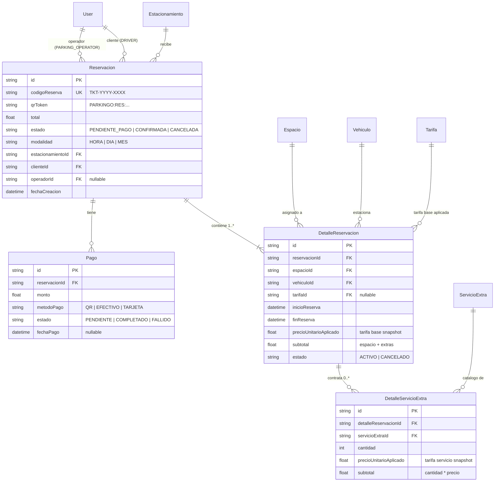
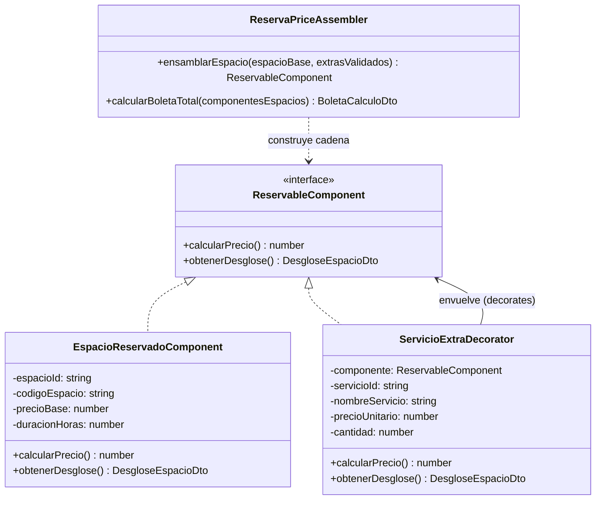

# Plan de Implementación: Boleta de Reserva de Estacionamiento con Patrón Decorator (GoF)

| Metadato | Detalle |
| :--- | :--- |
| **Proyecto** | ParkinGo (`parkingo-api` & `parking-go-front`) |
| **Módulo** | Reservas y Boletas (`ReservasModule` / `DriverBooking`) |
| **Patrón Aplicado** | Decorator Estructural GoF (Skill `/decorator-pattern`) |
| **Fecha de Elaboración** | 28 de Octubre de 2026 |
| **Estado** | Propuesta para Aprobación |

---

## 1. Alcance, Contexto y Reglas de Negocio

### 1.1 Objetivo
Implementar de extremo a extremo la emisión, cotización, consulta y cancelación de una **Boleta de Reserva de Estacionamiento** que puede contener **uno o varios espacios** de estacionamiento. A su vez, cada espacio puede contener **cero, uno o múltiples servicios extras dinámicos** (lavado, aspirado, carga eléctrica, etc.) configurados en el catálogo de base de datos por los operadores del parqueo, sin crear subclases de código por cada servicio.

### 1.2 Reglas Innegociables de Seguridad y Control de Acceso
1. **Registro Restringido:** Solo los usuarios con roles **Conductor (`DRIVER`)** y **Operador de Parqueo (`PARKING_OPERATOR`)** pueden registrar una boleta de reserva. Se prohíbe el registro a roles como `PARKING_ADMIN`, `GENERAL_ADMIN` y `HOST` (retorna HTTP `403 Forbidden`).
2. **Aislamiento de Administradores:** Solo el **Administrador de Parqueo (`PARKING_ADMIN` / `HOST` dueño)** puede consultar las boletas vinculadas a sus respectivos estacionamientos.
3. **Bloqueo a Administrador General:** El **Administrador General (`GENERAL_ADMIN`) NO podrá ver las reservas de nadie**; sus consultas a este módulo retornarán `403 Forbidden`.
4. **Estado y Ocupación Inmediata:** Toda boleta recién registrada se creará en estado **`PENDIENTE_PAGO`**, pero este estado ya aparta y reserva los espacios seleccionados, impidiendo que otro usuario reserve el mismo espacio en intervalos traslapados `[inicio, fin)`.
5. **Cancelación Exclusiva por el Cliente:** **Solo el cliente (`cliente_id` / conductor)** que originó la reserva tiene permisos para cancelarla (`cancelar-reserva.action.ts`). Ni el operador ni otros roles podrán cancelarla mediante este flujo.
6. **Snapshots Históricos:** La boleta almacena de forma inmutable la tarifa base del espacio y el precio unitario de cada servicio extra al momento de la confirmación. Modificar los catálogos en el futuro no alterará boletas preexistentes.

---

## 2. Modelo Relacional y Migración Prisma

Se incorporan cuatro entidades en [prisma/schema.prisma](file:///home/brayan/Documentos/Proyectos/Chamba/parkinGo/parkingo-api/prisma/schema.prisma):



### Enums Asociados:
- `EstadoReserva`: `PENDIENTE_PAGO`, `CONFIRMADA`, `EN_CURSO`, `COMPLETADA`, `CANCELADA`.
- `EstadoDetalleReserva`: `ACTIVO`, `CANCELADO`.
- `EstadoPago`: `PENDIENTE`, `COMPLETADO`, `FALLIDO`, `REEMBOLSADO`.

---

## 3. Diseño del Patrón Decorator (GoF)

Ubicación: `parkingo-api/src/modules/reservas/domain/decorator/`



### Funciones de los Roles GoF:
1. **Component (`ReservableComponent`):** Contrato común que expone `calcularPrecio(): number` y `obtenerDesglose(): DesgloseEspacioDto`.
2. **ConcreteComponent (`EspacioReservadoComponent`):** Calcula la tarifa base del espacio en el intervalo de tiempo (ej. 2 horas × 10 Bs = 20 Bs).
3. **Decorator Genérico (`ServicioExtraDecorator`):**
   - Implementa `ReservableComponent` y encapsula a otro `ReservableComponent`.
   - Suma el importe del servicio extra: `componente.calcularPrecio() + (precioUnitario * cantidad)`.
   - **Cero subclases:** Funciona para lavado, aspirado, carga EV o cualquier nuevo servicio creado por el usuario.
4. **Assembler (`ReservaPriceAssembler`):** Construye la cadena recursiva de decoradores por cada espacio y suma los subtotales para determinar el total definitivo de la boleta.

---

## 4. Contratos API del Backend (`parkingo-api`)

Todos los endpoints residen en `@Controller('reservas')` protegidos por `JwtAuthGuard` y `RolesGuard`:

| Método | Ruta | Roles | Descripción |
| :--- | :--- | :--- | :--- |
| `POST` | `/reservas/cotizar` | `DRIVER`, `PARKING_OPERATOR` | Cotiza en memoria usando el Assembler Decorator. Retorna subtotales por espacio y total. |
| `POST` | `/reservas` | `DRIVER`, `PARKING_OPERATOR` | Valida colisión de intervalos en transacción PostgreSQL, crea boleta `PENDIENTE_PAGO` y persiste snapshots. |
| `GET` | `/reservas/mis-reservas` | `DRIVER` | Retorna el historial de boletas del conductor en sesión. |
| `GET` | `/reservas/estacionamiento/:id` | `PARKING_ADMIN`, `HOST`, `PARKING_OPERATOR` | Retorna reservas del estacionamiento verificando pertenencia del operador/administrador. |
| `GET` | `/reservas/:id` | `DRIVER`, `PARKING_ADMIN`, `PARKING_OPERATOR` | Detalle exhaustivo de una boleta, desglose de espacios, extras y token QR. |
| `PATCH` | `/reservas/:id/cancelar` | `DRIVER` (exclusivo) | Cancela la reserva si `reserva.clienteId === user.userId`. Libera los espacios asociados. |

> [!WARNING]
> Si un usuario con rol `GENERAL_ADMIN` intenta consultar `/reservas` o `/reservas/:id`, la política de autorización denegará el acceso inmediatamente (`403 Forbidden`).

---

## 5. Arquitectura por Capas en Frontend (`parking-go-front`)

Siguiendo el protocolo `frontend-workflow.md`:

```
parking-go-front/src/modules/reservas/ (o integrado en driver/)
├── domain/
│   ├── BoletaReserva.ts           # Modelos de dominio y DTOs estrictos (0 any)
│   └── ReservaRepository.ts       # Contrato de repositorio
├── infrastructure/
│   ├── HttpReservaRepository.ts   # Implementación Axios con parkingoApi
│   └── mappers/ReservaMapper.ts   # Mapeo de DTOs del backend a tipos UI
├── application/
│   ├── useReservaQueries.ts       # useCotizarReservaQuery, useMisReservasQuery
│   └── useReservaMutations.ts     # useCrearReservaMutation, useCancelarReservaMutation
└── presentation/
    ├── components/
    │   ├── MultiEspacioSelector.tsx     # Selector de múltiples plazas disponibles
    │   ├── ExtrasPorEspacioPicker.tsx   # Selección de servicios extras por plaza
    │   ├── DesgloseBoletaLiveCard.tsx   # Visualización reactiva de subtotales y total
    │   └── BoletaTicketModal.tsx        # Modal con ticket QR y estado PENDIENTE_PAGO
    └── pages/
        └── DriverReservasPage.tsx       # Gestión completa de reservas del conductor
```

---

## 6. Matriz de Pruebas Obligatorias

| ID | Tipo de Prueba | Escenario de Validación | Criterio de Éxito |
| :---: | :--- | :--- | :--- |
| **T01** | Unitaria Decorator | 1 Espacio sin extras | Devuelve exactamente la tarifa base (`20 Bs`). |
| **T02** | Unitaria Decorator | 1 Espacio con múltiples extras | Espacio (20 Bs) + Lavado (15 Bs) + Aspirado (10 Bs) = `45 Bs`. |
| **T03** | Dominio / Assembler | 3 Espacios con diferentes extras (Escenario del prompt) | Espacio A (45 Bs) + Espacio B (55 Bs) + Espacio C (18 Bs) = **`118 Bs`**. |
| **T04** | Integración Catálogo | Servicio nuevo en BD | Creado en runtime, el decorador lo calcula sin tocar código TypeScript. |
| **T05** | Integración Snapshots | Cambio de tarifa en catálogo | Modificar la tarifa en BD no altera boletas creadas previamente. |
| **T06** | Concurrencia BD | Dos reservas para el mismo espacio e intervalo | La transacción atómica rechaza la segunda con error de colisión de disponibilidad. |
| **T07** | Autorización | Intento de registro por `PARKING_ADMIN` o `GENERAL_ADMIN` | El sistema responde `403 Forbidden`. |
| **T08** | Cancelación | Operador o Administrador intenta cancelar | Rechazado: solo el cliente dueño (`cliente_id`) puede cancelarla. |
| **T09** | Frontend | Tolerancia cero a `any` | `npx tsc --noEmit` finaliza con 0 errores de compilación. |

---

## 7. Plan de Ejecución Paso a Paso

```
[ Paso 1: Backend DB ]  ──>  [ Paso 2: Dominio Decorator ]  ──>  [ Paso 3: Actions & Controller ]
   Migración Prisma             Clases e Interfaces GoF             CRUD, Cotización y Roles
                                                                                 │
                                                                                 ▼
[ Paso 6: Verificación ] <──  [ Paso 5: Frontend UI/Hooks ] <──  [ Paso 4: Tests Backend ]
   Builds y Pruebas                Zustand, Query & Modal            Suite unitaria y transaccional
```

1. **Paso 1:** Actualizar [prisma/schema.prisma](file:///home/brayan/Documentos/Proyectos/Chamba/parkinGo/parkingo-api/prisma/schema.prisma) con los modelos de reservas y ejecutar `npx prisma db push` o migración correspondiente.
2. **Paso 2:** Implementar la jerarquía Decorator GoF en `src/modules/reservas/domain/decorator/`.
3. **Paso 3:** Implementar el módulo `reservas` con sus Actions, Controller, DTOs y Mappers en `parkingo-api`.
4. **Paso 4:** Crear y ejecutar la suite de pruebas unitarias del decorador (`test/reservas/decorator-price.spec.ts`).
5. **Paso 5:** Registrar el módulo en [backend_graph.json](file:///home/brayan/Documentos/Proyectos/Chamba/parkinGo/parkingo-api/backend_graph.json) y compilar backend (`npm run build`).
6. **Paso 6:** Implementar la integración en el frontend (`parking-go-front`) con selector multi-espacio, extras por espacio y ticket QR en `PENDIENTE_PAGO`.
7. **Paso 7:** Validación completa con `npx tsc --noEmit` y `npm run build`.
